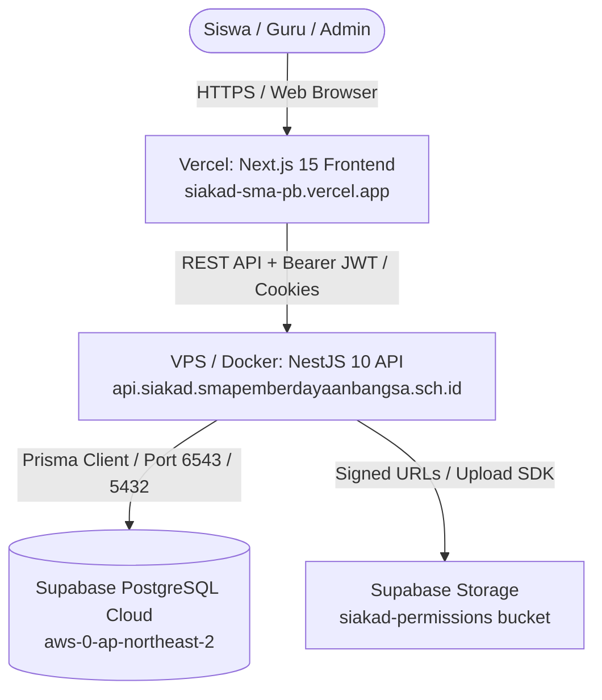

# Panduan Deployment SIAKAD Next.js Frontend ke Vercel

Dokumen ini merupakan panduan resmi langkah demi langkah (*step-by-step*) untuk mendeploy aplikasi web frontend **SIAKAD SMA Pemberdayaan Bangsa** (Next.js 15 App Router) ke platform **Vercel** melalui integrasi repositori GitHub (`magangsmapb-code/SIAKAD-APP`).

---

## 1. Arsitektur Monorepo & Pembagian Komponen

Repositori `magangsmapb-code/SIAKAD-APP` mengadopsi struktur monorepo/hybrid:
1. **Frontend Web (Next.js 15)**: Berada di root direktori (`./`, `src/`, `package.json`, `next.config.mjs`). **Komponen inilah yang dideploy ke Vercel**.
2. **Backend API (NestJS 10 & Prisma)**: Berada di direktori `apps/api/` (dideploy ke VPS / Docker / Railway / Render).
3. **Mobile App (Flutter)**: Berada di direktori `apps/mobile/` (dibuild menjadi APK/AAB Android).
4. **Database & Storage**: Di-host di Supabase Cloud (`aymuesprbohoznguuyym`).

---

## 2. Prasyarat Deployment

Sebelum memulai deployment ke Vercel, pastikan:
- Repositori GitHub telah terupdate dengan commit terbaru (`git push origin main` sudah sukses).
- Memiliki akun [Vercel](https://vercel.com) yang terhubung dengan akun GitHub pemilik repositori (`magangsmapb-code`).
- Memiliki URL backend API yang aktif (contoh: `https://api.siakad.smapemberdayaanbangsa.sch.id/api/v1` atau URL staging backend).

---

## 3. Langkah-Langkah Deployment ke Vercel

### Langkah 1: Impor Proyek dari GitHub
1. Masuk ke dashboard [Vercel](https://vercel.com).
2. Klik tombol **"Add New..."** di pojok kanan atas, lalu pilih **"Project"**.
3. Di bagian **"Import Git Repository"**, cari repositori **`magangsmapb-code/SIAKAD-APP`** (atau `SIAKAD-APP`).
4. Klik tombol **"Import"**.

---

### Langkah 2: Konfigurasi Project Settings
Pada halaman **Configure Project**, sesuaikan pengaturan berikut:

| Parameter | Nilai Pengaturan | Penjelasan |
|---|---|---|
| **Project Name** | `siakad-sma-pb` (atau sesuai keinginan) | Nama proyek di dashboard Vercel dan sub-domain default (`siakad-sma-pb.vercel.app`). |
| **Framework Preset** | `Next.js` | Vercel akan otomatis mendeteksi Next.js 15. |
| **Root Directory** | `./` (default) | Biarkan `./` karena frontend Next.js berada langsung di root repositori. |
| **Build Command** | `npm run build` | Default build Next.js (menjalankan `next build`). |
| **Output Directory** | `.next` | Default build output Next.js. |
| **Install Command** | `npm install` atau `npm ci` | Menginstal dependensi root (`node_modules`). |

---

### Langkah 3: Konfigurasi Environment Variables di Vercel

Buka bagian **"Environment Variables"** pada form konfigurasi Vercel dan tambahkan variabel berikut:

| Key (Nama Variabel) | Contoh Value (Nilai) | Lingkungan | Keterangan |
|---|---|---|---|
| `NEXT_PUBLIC_API_URL` | `https://api.siakad.smapemberdayaanbangsa.sch.id/api/v1` | Production, Preview, Development | Base endpoint REST API backend NestJS yang diakses oleh browser klien. |

> **PENTING (Keamanan Kredensial):**
> **JANGAN PERNAH** memasukkan `DATABASE_URL`, `SUPABASE_SERVICE_ROLE_KEY`, atau `JWT_SECRET` ke dalam Vercel Environment Variables. Variabel rahasia tersebut adalah milik backend (`apps/api`) dan tidak boleh terekspos ke bundle browser frontend Next.js.

---

### Langkah 4: Jalankan Deployment
1. Klik tombol **"Deploy"**.
2. Vercel akan otomatis meng-clone repositori, menginstal dependensi (`npm install`), menjalankan lint/typecheck, dan melakukan build static generation (`Generating static pages 16/16`).
3. Setelah selesai dalam waktu ~1–2 menit, Vercel akan menampilkan status **"Congratulations! You deployed your project"** beserta link domain aktif (misal: `https://siakad-sma-pb.vercel.app`).

---

## 4. Konfigurasi Lanjutan Pasca-Deploy

### A. Sinkronisasi CORS di Backend NestJS
Agar web Next.js di Vercel dapat melakukan request HTTP (login, absensi, izin) ke backend tanpa diblokir oleh browser, tambahkan domain Vercel Anda ke file `.env` di backend NestJS:

```env
# apps/api/.env
CORS_ORIGINS="https://siakad-sma-pb.vercel.app,https://siakad.smapemberdayaanbangsa.sch.id,http://localhost:3000"
```
Setelah itu, restart layanan backend NestJS Anda agar perubahan CORS aktif.

### B. Custom Domain (Opsional / Sekolah)
Jika sekolah memiliki domain resmi (contoh: `siakad.smapemberdayaanbangsa.sch.id`):
1. Masuk ke **Project Settings** $\rightarrow$ **Domains** di dashboard Vercel.
2. Tambahkan domain/subdomain sekolah Anda.
3. Konfigurasikan CNAME record di DNS provider domain Anda sesuai petunjuk yang diberikan Vercel.
4. Vercel akan otomatis menerbitkan sertifikat SSL/TLS gratis (Let's Encrypt).

### C. Automatic CI/CD Deployments
Setiap kali Anda menjalankan `git push origin main` dari lokal:
- Vercel akan secara otomatis mendeteksi commit baru.
- Menjalankan build baru secara instan (*Zero-downtime deployment*).
- Jika ada Pull Request (PR), Vercel akan membuatkan *Preview Deployment URL* otomatis untuk pengujian sebelum digabungkan ke `main`.

---

## 5. Ringkasan Integrasi Menyeluruh (Full-Stack Checklist)



1. **GitHub**: Pusat kode sumber (`magangsmapb-code/SIAKAD-APP`).
2. **Vercel**: Menjalankan frontend Next.js 15 berkecepatan tinggi dengan edge caching.
3. **NestJS API Backend**: Memproses autentikasi, validasi Anti-IDOR, guard peran, dan business logic absensi.
4. **Supabase Cloud**: Basis data relasional PostgreSQL dan penyimpanan aman berkas lampiran izin.
