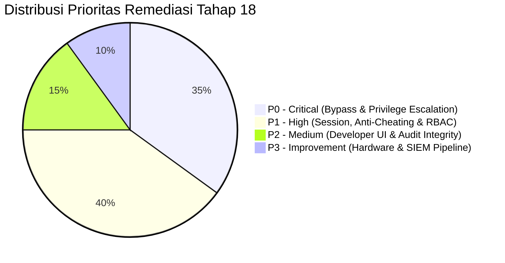

# 📋 SECURITY REMEDIATION PLAN (TAHAP 18)
## SIAKAD SMA Pemberdayaan Bangsa Ngrayun, Ponorogo
*Versi Dokumen: 1.0.0 | Prioritas: P0 — P3 Berbasis Risiko | Tanggal: 21 Oktober 2026*

---

### 1. Prinsip Prioritas Remediasi

Remediasi keamanan Tahap 18 berfokus pada mitigasi risiko nyata berdasarkan dampak dan probabilitas temuan baseline, bukan sekadar jumlah baris kode yang diubah. Seluruh perbaikan harus menjaga stabilitas sistem dan kelulusan seluruh baseline test tanpa migrasi destruktif.

---

### 2. Matriks Rencana Aksi Remediasi

#### P0 — Critical (Eksekusi Segera)

| ID | Sasaran Remediasi | Modul Terdampak | Langkah Implementasi | Status |
| :--- | :--- | :--- | :--- | :--- |
| **P0-1** | **Cabut Bypass Otomatis Peran `DEVELOPER`** | `common/guards/roles.guard.ts`, `common/guards/permissions.guard.ts` | Hapus pengecualian otomatis `user.role === Role.DEVELOPER`. Developer wajib melewati pemeriksaan izin granular di `PermissionsGuard`. | **IMPLEMENTED** |
| **P0-2** | **Isolasi Permission Peran `DEVELOPER`** | `modules/features/features.service.ts` | Tetapkan izin default `DEVELOPER` khusus tata kelola infrastruktur (`users.view`, `settings.view`, `settings.manage`, `audit.view`, `developer.manage_features`, `developer.view_diagnostics`, `attendance.manage_settings`, `attendance.manage_feature_access`). Larang mutasi presensi/nilai. | **IMPLEMENTED** |
| **P0-3** | **Cegah Eskalasi Hak Akses ke `DEVELOPER`** | `modules/users/users.service.ts` | Tambahkan validasi: hanya `SUPER_ADMIN` yang berhak menetapkan peran `DEVELOPER` atau `SUPER_ADMIN` pada pembuatan atau pembaruan akun. | **IMPLEMENTED** |
| **P0-4** | **Pencabutan Sesi Seketika (Session Revocation)** | `modules/users/users.service.ts` | Atur `refreshToken: null` saat kata sandi diperbarui atau akun dinonaktifkan (`isActive: false`), memutuskan seluruh sesi aktif yang berpotensi disalahgunakan. | **IMPLEMENTED** |

#### P1 — High (Hardening Kontrol & Anti-Cheating)

| ID | Sasaran Remediasi | Modul Terdampak | Langkah Implementasi | Status |
| :--- | :--- | :--- | :--- | :--- |
| **P1-1** | **Penerapan PermissionsGuard pada Modul Pengguna** | `modules/users/users.controller.ts` | Pasang `@UseGuards(PermissionsGuard)` dan dekorator izin granular `@Permission('users.view')`, `@Permission('users.create')`, `@Permission('users.update')`. | **IMPLEMENTED** |
| **P1-2** | **Agregasi Deteksi Anomali Absensi** | `modules/attendance/attendance.service.ts`, `attendance.controller.ts` | Catat event audit khusus `ATTENDANCE_ANOMALY_DETECTED` saat terjadi kegagalan absensi di luar radius, di luar jam WIB, atau percobaan ganda. Sediakan endpoint `GET /attendance/anomalies`. | **IMPLEMENTED** |
| **P1-3** | **Endpoint Diagnostik Keamanan Non-Destruktif** | `modules/features/features.service.ts`, `features.controller.ts` | Bangun `getSecurityOverview()` dan `runSecurityDiagnostics()` untuk menguji integritas DB, token entropy, throttler, status geofencing, dan isolasi modul unbuilt. | **IMPLEMENTED** |
| **P1-4** | **Validasi Status Modul yang Belum Diimplementasikan** | `modules/features/features.service.ts` | Daftarkan `feat_tu_payment_gateway` dan `feat_notification_whatsapp` sebagai `NOT_IMPLEMENTED` bersama `feat_grading_examination` agar terkunci di tingkat sistem. | **IMPLEMENTED** |

#### P2 — Medium (Integrasi Developer Dashboard & Dokumentasi)

| ID | Sasaran Remediasi | Modul Terdampak | Langkah Implementasi | Status |
| :--- | :--- | :--- | :--- | :--- |
| **P2-1** | **Tab Keamanan di Developer Dashboard** | `src/features/settings/components/developer-dashboard-view.tsx` | Tambahkan tab `SECURITY` yang menampilkan postur keamanan, daftar risiko, status MFA/rate limiting, status modul unbuilt, dan tombol uji coba diagnostik non-destruktif. | **IMPLEMENTED** |
| **P2-2** | **Katalog Event Audit & Integritas Bukti** | `docs/security/audit-event-catalog.md`, `audit-log-integrity.md` | Dokumentasikan seluruh struktur payload event audit, format sanitasi, dan mitigasi anti-repudiation. | **IMPLEMENTED** |
| **P2-3** | **Kebijakan Privasi Data & Retensi Dokumen** | `docs/security/student-data-privacy.md`, `data-retention-policy.md` | Susun standar perlindungan data siswa, aturan minimisasi data lokasi GPS, dan kebijakan penyimpanan catatan akademik. | **IMPLEMENTED** |

#### P3 — Improvement (Arsitektur Jangka Panjang & Integrasi Lanjutan)

| ID | Sasaran Remediasi | Modul Terdampak | Langkah Implementasi | Status |
| :--- | :--- | :--- | :--- | :--- |
| **P3-1** | **Spesifikasi Adapter Object Storage Privat** | `docs/security/production-readiness.md` | Dokumentasikan arsitektur private bucket S3/MinIO dan generator signed URL berumur pendek untuk lampiran surat sakit/izin. | **DOCUMENTED** |
| **P3-2** | **Spesifikasi Protokol Keamanan Kiosk Fisik RFID** | `docs/security/threat-model.md` | Rancang autentikasi HMAC-SHA256 per perangkat ESP32 sebelum integrasi gerbang fisik diproduksi. | **DOCUMENTED** |
| **P3-3** | **Pipeline Export Security Event SIEM** | `docs/security/incident-response.md` | Buat format JSON standar untuk integrasi log insiden keamanan ke Elasticsearch / OpenSearch di masa depan. | **DOCUMENTED** |
