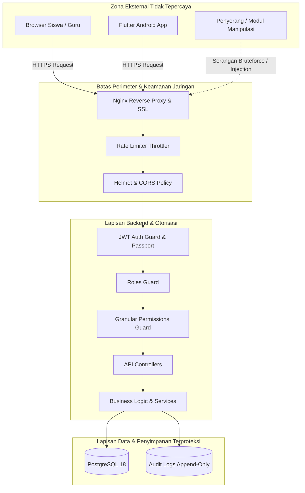

# 🎯 STRIDE & OWASP THREAT MODEL
## SIAKAD SMA Pemberdayaan Bangsa Ngrayun, Ponorogo
*Versi Dokumen: 1.0.0 | Standar: OWASP Top 10 (2021) & OWASP API Security Top 10 (2023) | Tanggal: 21 Oktober 2026*

---

### 1. Metodologi Pemodelan Ancaman

Pemodelan ancaman SIAKAD SMA Pemberdayaan Bangsa menggunakan kombinasi kerangka kerja **STRIDE** (Spoofing, Tampering, Repudiation, Information Disclosure, Denial of Service, Elevation of Privilege) dan **OWASP API Security Top 10** guna menganalisis batas-batas kepercayaan (*trust boundaries*), aset berharga, dan vektor serangan potensial.

---

### 2. Matriks Pemodelan Ancaman Sistem Akademik

Tabel berikut merangkum 15 vektor ancaman spesifik yang dievaluasi dalam arsitektur sistem:

| ID | Ancaman (*Threat*) | Aset Terancam | Titik Masuk (*Entry Point*) | Dampak | Probabilitas | Kontrol Eksisting | Mitigasi Tahap 18 | Risiko Residual | Bukti Pengujian |
| :--- | :--- | :--- | :--- | :--- | :--- | :--- | :--- | :--- | :--- |
| **TH-01** | **Account Takeover via Brute Force** | Akun Guru, Admin, Siswa | `POST /auth/login` | Tinggi | Sedang | Password hash bcrypt, pesan error seragam tanpa enumerasi | Throttler (100 req/min), audit kegagalan login (`AUTH_LOGIN_FAILED`) | Kemungkinan serangan terdistribusi dari multiple IP | Test auth rate limit & generic error |
| **TH-02** | **Privilege Escalation Developer Bypass** | Integritas nilai & presensi | Guard backend (`roles.guard`, `permissions.guard`) | Kritis | Sedang | RBAC berbasis Prisma | Cabut bypass otomatis Developer; batasi permission Developer ke lingkup teknis saja | Developer masih memiliki akses SSH/database server langsung | Test developer blocked from modifying attendance |
| **TH-03** | **IDOR Data Siswa (BOLA)** | Profil & data pribadi siswa | `GET /students/:id` | Tinggi | Tinggi | Validasi `currentUser.studentId` | Enforce server-side check di controller & service, reject query lintas ID | Admin & Wali Kelas sah tetap dapat melihat data kelasnya | Test student querying different studentId receives 403 |
| **TH-04** | **Manipulasi Presensi Mandiri (Fake GPS)** | Catatan kehadiran guru/murid | `POST /attendance/teacher/check-in`, `POST /attendance/student/check-in` | Sedang | Tinggi | Perhitungan jarak Haversine, batas toleransi radius sekolah | Validasi koordinat server-side, validasi jam WIB server, rekam audit distance anomaly | Klien mobile yang di-root dengan mock location OS-level | Test coordinate outside school boundary rejected |
| **TH-05** | **Check-in Ganda / Balapan Sesi (Race Condition)** | Konsistensi data kehadiran | `POST /attendance/records`, `POST /attendance/student/check-in` | Sedang | Sedang | Unique constraint `@@unique([sessionId, studentId])` | Database transaction ACID, in-memory duplicate set check sebelum insert | Beban koneksi DB tinggi jika ribuan siswa tap serentak | Test concurrent duplicate check-in rejected |
| **TH-06** | **Manipulasi Waktu Klien (Client Clock Skew)** | Rekam status Terlambat vs Hadir | Payload request check-in | Sedang | Tinggi | Jam server WIB (`getCurrentWibTime`) digunakan sebagai patokan | Server mengabaikan timestamp dari body request klien; waktu server adalah kebenaran tunggal | Sinkronisasi NTP server host jika jam server lokal melenceng | Test request with future/past timestamp uses server time |
| **TH-07** | **Pencurian & Penggunaan Ulang Refresh Token** | Sesi autentikasi pengguna | `POST /auth/refresh` | Tinggi | Rendah | Refresh token di-hash di DB | Token rotation: setiap refresh menerbitkan token baru; jika hash tidak cocok, cabut semua sesi | XSS pada browser dapat mencuri token jika cookie tidak HttpOnly | Test token reuse triggers `SECURITY_TOKEN_REUSE_DETECTED` |
| **TH-08** | **Privilege Escalation Role Assign** | Hak administratif pengguna | `POST /users`, `PATCH /users/:id` | Kritis | Rendah | Role default `STUDENT` | Hanya `SUPER_ADMIN` yang dapat menetapkan peran `SUPER_ADMIN` atau `DEVELOPER` | Super admin yang terkompromi dapat mengangkat akun lain | Test Admin assigning Developer role throws 403 |
| **TH-09** | **Aktivasi Modul Semu (Fake Feature Enable)** | Modul ujian (`feat_grading_examination`) | `PATCH /features/:key` | Kritis | Sedang | `FeaturesService.update` memblokir `NOT_IMPLEMENTED` | Strict architectural lock: tidak dapat diaktifkan jika implementasi belum ada di codebase | Perubahan manual pada database via psql | Test enabling `feat_grading_examination` throws 400 |
| **TH-10** | **Manipulasi Audit Trail (Repudiation)** | Jejak bukti hukum & investigasi | Endpoint API & DB | Kritis | Sangat Rendah | `AuditService` bersifat append-only | Tidak menyediakan rute/endpoint update atau delete pada `AuditLog` | Akses langsung superuser psql ke database | Test no audit update/delete method in API |
| **TH-11** | **Kebocoran Rahasia via Audit Log / Error Log** | Password, Token JWT, Secrets | Log sistem, response JSON | Kritis | Sedang | `HttpExceptionFilter` tanpa stack trace di production | `AuditService.sanitizeData()` otomatis mengubah keyword rahasia menjadi `[REDACTED]` | Penulisan console.log manual oleh developer saat debug | Test audit log with password returns `[REDACTED]` |
| **TH-12** | **Sesi Tidak Dicabut Setelah Ganti Password** | Akun pengguna terkompromi | `PATCH /users/:id` | Tinggi | Sedang | Password ter-hash bcrypt | Pasang `refreshToken: null` saat password diubah atau user dinonaktifkan | Access token 15 menit tetap berlaku hingga kedaluwarsa alami | Test old refresh token rejected after password change |
| **TH-13** | **Koreksi Absensi Tanpa Jejak (Silent Tampering)** | Histori presensi siswa | `POST /attendance/corrections` | Sedang | Sedang | Tabel `attendance_corrections` | Alur dua tahap: status awal `MENUNGGU`, approval oleh Wali Kelas, simpan `previousStatus` & `newStatus` | Rekonsiliasi manual periodik oleh Kepala Sekolah | Test correction request generates approval workflow |
| **TH-14** | **Parameter Injection / Mass Assignment** | Field tak terduga pada entitas | Seluruh endpoint POST/PATCH | Tinggi | Sedang | `ValidationPipe({ forbidNonWhitelisted: true })` | DTO ketat dengan class-validator pada semua request payload | Payload JSON sangat dalam yang menghabiskan CPU parser | Test request with illegal field throws 400 BadRequest |
| **TH-15** | **Path Traversal / Eksekusi File Unggahan** | Integritas filesystem server | Lampiran izin/sakit | Kritis | Rendah | Metadata teks disimpan, file lokal belum dieksekusi | File storage dinyatakan `NOT_CONFIGURED` hingga implementasi MinIO/S3 private selesai | URL eksternal yang diinput siswa mengarah ke phishing | Test attachment validation restricts safe URI format |

---

### 3. Batas Kepercayaan (*Trust Boundaries*)

1. **Boundary 1: Klien (Browser / Mobile) vs API Gateway**:
   - Seluruh data dari klien dianggap **TIDAK TERPERCAYA**.
   - Validasi DTO, validasi tipe data, dan sanitasi input dieksekusi secara ketat di server.
2. **Boundary 2: Pengguna Terautentikasi vs Kewenangan Data (Authorization)**:
   - Identitas token valid tidak otomatis memberikan hak akses ke seluruh resource.
   - Otorisasi memeriksa keterkaitan pemilik (Guru hanya melihat kelas ampuan; Siswa hanya melihat diri sendiri).
3. **Boundary 3: Peran Teknis (Developer) vs Operasional Akademik**:
   - Peran `DEVELOPER` dikunci pada pengelolaan infrastruktur dan tidak diperbolehkan mengubah nilai atau catatan kehadiran siswa secara operasional.
4. **Boundary 4: Lapisan Aplikasi vs Lapisan Audit**:
   - Log audit bersifat *append-only*. Kegagalan audit log tidak boleh menutupi aksi sensitif secara diam-diam.
