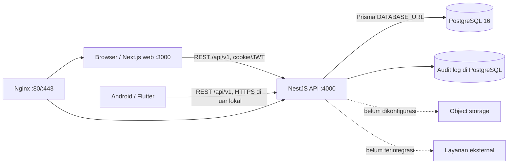

# Panduan SIAKAD SMA Pemberdayaan Bangsa

**Versi dokumentasi:** 1.0.0  
**Diperbarui:** 21 Oktober 2026  
**Cakupan:** pengembangan lokal, operasi teknis, pengelolaan aplikasi, dan deployment  
**Peringatan:** panduan ini menjelaskan implementasi yang ditemukan di repository. Ia bukan bukti bahwa sistem sudah berjalan di server production atau siap dipakai untuk data siswa nyata.

> **Penting — baca sebelum menjalankan:** repository berisi aplikasi web Next.js, REST API NestJS, PostgreSQL/Prisma, dan aplikasi Flutter. Beberapa layar dan data adalah demo, dan ada area yang belum tersambung end-to-end. Nilai konfigurasi perlu disesuaikan dan diverifikasi untuk setiap environment. Jangan gunakan seed, kredensial contoh, database lokal, atau build debug untuk production. Jangan menyalin isi `.env`, log yang berisi data pribadi, signing key, maupun dump database ke tiket publik.

## Daftar isi

- [Quick Start](#quick-start)
- [1. Gambaran umum](#1-gambaran-umum)
- [2. Persiapan lingkungan](#2-persiapan-lingkungan)
- [3. Clone dan setup proyek](#3-clone-dan-setup-proyek)
- [4. Environment dan pengelolaan secret](#4-environment-dan-pengelolaan-secret)
- [5. Database dan Prisma](#5-database-dan-prisma)
- [6. Menjalankan website lokal](#6-menjalankan-website-lokal)
- [7. Menjalankan backend dan API](#7-menjalankan-backend-dan-api)
- [8. Menjalankan aplikasi Android/Flutter](#8-menjalankan-aplikasi-androidflutter)
- [9. Menjalankan seluruh sistem](#9-menjalankan-seluruh-sistem)
- [10. Role, akun, dan permission](#10-role-akun-dan-permission)
- [11. Developer Dashboard dan Feature Registry](#11-developer-dashboard-dan-feature-registry)
- [12. Menginput dan mengelola data](#12-menginput-dan-mengelola-data)
- [13. Menambah fitur baru](#13-menambah-fitur-baru)
- [14. Mengubah role dan permission](#14-mengubah-role-dan-permission)
- [15. Upgrade dan pemeliharaan](#15-upgrade-dan-pemeliharaan)
- [16. Git dan kolaborasi](#16-git-dan-kolaborasi)
- [17. Website di GitHub dan Vercel](#17-website-di-github-dan-vercel)
- [18. Deployment backend, database, dan storage](#18-deployment-backend-database-dan-storage)
- [19. Build dan distribusi APK](#19-build-dan-distribusi-apk)
- [20. Testing dan checklist rilis](#20-testing-dan-checklist-rilis)
- [21. Troubleshooting](#21-troubleshooting)
- [Quick Troubleshooting](#quick-troubleshooting)
- [22. Backup, restore, dan disaster recovery](#22-backup-restore-dan-disaster-recovery)
- [23. Keamanan dan penanganan insiden](#23-keamanan-dan-penanganan-insiden)
- [24. Status fitur dan roadmap](#24-status-fitur-dan-roadmap)
- [25. Hal yang belum terverifikasi](#25-hal-yang-belum-terverifikasi)
- [26. Glosarium dan referensi](#26-glosarium-dan-referensi)
- [Production Readiness](#production-readiness)
- [Evidence Log](#evidence-log)

## Quick Start

Panduan ringkas ini untuk komputer development baru. Perintah hanya menyiapkan lingkungan lokal dan tidak menjalankan seed, migration production, atau deployment. Jalankan di PowerShell; ganti path workspace jika berbeda.

### 1. Prasyarat dan dependency

Pastikan Git, Node.js 20, npm, Docker Compose, Flutter 3.47.7/Dart 3.13.5 terpasang. Android Studio/SDK hanya diperlukan untuk target Android. Verifikasi dengan `git --version`, `node --version`, `npm --version`, `docker compose version`, dan `flutter doctor -v`.

Clone dan pasang dependency dari folder yang sesuai:

```powershell
git clone <URL_REPOSITORY_GITHUB> "C:\workspace\SIAKAD APP"
Set-Location "C:\workspace\SIAKAD APP"
npm ci

Set-Location "C:\workspace\SIAKAD APP\apps\api"
npm ci

Set-Location "C:\workspace\SIAKAD APP\apps\mobile"
flutter pub get
```

Jika clone gagal, minta URL/akses kepada pemilik repository. Jangan menaruh token akses dalam URL atau output terminal yang dibagikan.

### 2. Siapkan database dan environment development

Compose database development berada di `apps/api`, bukan Compose production:

```powershell
Set-Location "C:\workspace\SIAKAD APP\apps\api"
docker compose up -d postgres
docker compose ps
```

Compose development memuat kredensial tetap untuk database lokal; batasi ke komputer development terisolasi dan jangan pernah memakai file tersebut pada server. Jangan publikasikan port database ke jaringan.

Buat file lokal bila belum ada, lalu edit `.env.local` (web) dan `apps/api/.env` menggunakan URL localhost dan database Compose. Isi dua JWT secret berbeda dengan secret hasil generator CSPRNG/password manager yang disetujui; masing-masing minimal 32 karakter, bukan placeholder. Jangan menyalin secret ke chat, Git, log, atau dokumentasi.

```powershell
Set-Location "C:\workspace\SIAKAD APP"
if (-not (Test-Path ".env.local")) { Copy-Item ".env.example" ".env.local" }
if (-not (Test-Path "apps\api\.env")) { Copy-Item "apps\api\.env.example" "apps\api\.env" }
```

Template API sekarang memakai `NODE_ENV=development`. Template mengandung placeholder DB/JWT dan tidak siap dijalankan sebelum diisi. Validasi startup API menolak placeholder, secret pendek, secret sederhana/berulang, dan secret access-refresh yang sama.

### 3. Terapkan migration development

```powershell
Set-Location "C:\workspace\SIAKAD APP\apps\api"
npm run prisma:generate
npx prisma migrate status
npm run prisma:migrate
```

`prisma:migrate` menjalankan `prisma migrate dev` dan hanya boleh diarahkan ke DB development. Hasil yang diharapkan adalah seluruh migration tercatat tanpa error. Jika status memperlihatkan drift atau migration gagal, berhenti dan periksa URL/status; jangan menjalankan `prisma:reset`.

### 4. Jalankan API dan web pada terminal terpisah

Terminal 1:

```powershell
Set-Location "C:\workspace\SIAKAD APP\apps\api"
npm run start:dev
```

Verifikasi `http://localhost:4000/api/v1/health`; respons health yang diimplementasikan memberi status `ok`. Swagger berada di `http://localhost:4000/api/v1/docs`.

Terminal 2:

```powershell
Set-Location "C:\workspace\SIAKAD APP"
npm run dev
```

Buka URL yang dicetak Next.js (default `http://localhost:3000`, login di `/login`). Untuk memakai data server, API dan database harus aktif dan akun development yang sah harus sudah tersedia. Jangan menjalankan seed tanpa membaca [Peringatan seed](#54-seeder), karena seeder menetapkan password demo tetap.

Untuk berhenti: `Ctrl+C` pada terminal API dan web; hentikan DB lokal dengan `docker compose stop postgres` dari `apps/api` bila tidak dipakai lagi. Quick Start ini belum membuktikan alur login/fitur data tanpa akun serta UAT.

## 1. Gambaran umum

### 1.1 Tujuan dan batas penggunaan

SIAKAD adalah sistem informasi akademik yang berfokus terutama pada presensi, data siswa/guru, struktur kelas dan mata pelajaran, jadwal, pengajuan izin, rekap, akun, audit, serta konfigurasi modul. Nama dan identitas sekolah yang tertanam di kode adalah SMA Pemberdayaan Bangsa Ngrayun, Ponorogo.

Repository memuat implementasi nyata untuk web, API, schema database, migrasi, dan aplikasi Flutter. Namun, keberadaan halaman, endpoint, atau entri Feature Registry **tidak membuktikan** bahwa seluruh alur sudah teruji, tersambung ke data production, atau layak digunakan untuk keputusan akademik. Gunakan status pada [Bagian 24](#24-status-fitur-dan-roadmap), uji ulang alur lengkap di staging, dan lakukan UAT sebelum pemakaian sekolah.

### 1.2 Arsitektur dan alur request



Di development, web mengarah ke `NEXT_PUBLIC_API_URL` (default di kode `http://localhost:4000/api/v1`); API menggunakan prefix `/api/v1`. API Swagger ada di `/api/v1/docs`, dan health check di `/api/v1/health`. Flutter memilih endpoint melalui Dart compile-time define `API_BASE_URL`; emulator Android menggunakan `10.0.2.2` sebagai default untuk API yang berjalan di komputer host.

Production Compose yang tersedia mendefinisikan Nginx, web, API, PostgreSQL 16, backup cron, dan named volumes. PostgreSQL tidak dipetakan ke host/public port pada Compose production. Ini adalah konfigurasi yang ada di file, bukan bukti bahwa DNS, sertifikat TLS, VPS, backup off-site, atau layanan production benar-benar tersedia.

### 1.3 Teknologi yang diverifikasi dari repository

| Komponen | Versi/teknologi terverifikasi | Fungsi/catatan |
|---|---|---|
| Web | Next.js 15.1.7, React 19, TypeScript, Tailwind CSS 3.4 | App Router, direktori `src/`; output standalone |
| Backend | NestJS 10, TypeScript, Node.js 20 pada Docker dan CI | REST API modular, Swagger, throttling, Helmet |
| Database | PostgreSQL 16 pada Compose dan CI; Prisma 5.22 | Schema dan migrasi berada di `apps/api/prisma` |
| Web UI | Radix UI, React Hook Form, Zod, Recharts, Sonner | UI, form, validasi, visualisasi, notifikasi |
| Mobile | Flutter 3.47.7 stable dan Dart 3.13.5 pada SDK lokal/CI | Aplikasi Android; terdapat mode API dan demo |
| Android build | Java 17 pada workflow CI | Pengaturan Gradle memakai Flutter SDK defaults |
| CI | GitHub Actions | Lint/typecheck/build web; test/build backend; analyzer/test/build APK debug |
| Orkestrasi production | Docker Compose, Nginx | Didefinisikan di `docker-compose.prod.yml`; bukan Docker Compose lokal |

Node.js 20 adalah pilihan konsisten dengan Dockerfile dan CI. Batas minimum Node/npm tidak dipatok secara konsisten oleh seluruh manifest. Jangan menggunakan versi Node yang berbeda dari CI untuk mendiagnosis masalah build.

### 1.4 Direktori dan file penting

| Lokasi | Isi |
|---|---|
| `src/app`, `src/features`, `src/contexts`, `src/lib`, `src/mocks` | Route dan komponen web; client API, state aplikasi, serta data demo |
| `apps/api/src/modules` | Modul NestJS: auth, users, students, teachers, academic, attendance, permissions, reports, settings, features, audit, dashboard |
| `apps/api/src/common` | Guard, decorator, DTO umum, filter dan interceptor |
| `apps/api/prisma/schema.prisma` | Model, enum, relasi dan konfigurasi datasource PostgreSQL |
| `apps/api/prisma/migrations` | Lima migrasi SQL yang ada di repository |
| `apps/mobile/lib` | Flutter UI, state, repositories, API client, cache lokal dan mock |
| `apps/mobile/android` | Konfigurasi Gradle, manifest dan proyek Android |
| `scripts` | Backup/restore, migrasi, smoke test dan skrip audit |
| `nginx` | Konfigurasi reverse proxy |
| `docs/security`, `docs/testing`, `docs/uat` | Kebijakan dan catatan teknis; cocokkan dengan kode karena beberapa dokumen lama tidak selalu konsisten |
| `Dockerfile.web`, `apps/api/Dockerfile`, `docker-compose.prod.yml` | Build container dan konfigurasi deployment |
| `.env.example`, `.env.production.example`, `apps/api/.env.example`, `apps/api/.env.production.example`, `apps/mobile/.env.example` | Template; template mobile tidak otomatis dimuat sebagai file environment oleh Flutter |

Folder `Flutter/flutter` merupakan salinan SDK besar di workspace saat audit ini. Jangan menganggap folder tersebut sebagai source aplikasi; aplikasi berada di `apps/mobile`. Versi SDK yang terpasang di mesin lain tetap harus diverifikasi.

### 1.5 Port dan service

| Service | Port yang ditetapkan/dipakai | Paparan |
|---|---:|---|
| Next.js development/server | 3000 (default Next.js; Docker menetapkan 3000) | Lokal |
| NestJS API | 4000 (default backend dan Docker) | Lokal; di Compose production hanya jaringan Docker |
| PostgreSQL Compose development API | 5432 | Dipetakan ke host pada `apps/api/docker-compose.yml`; batasi ke localhost/firewall |
| PostgreSQL production Compose | 5432 internal | Tidak ada host mapping |
| Nginx Compose production | 80, 443 | Port masuk server |
| Flutter | Tidak membuka port service sendiri | Klien API; port tooling Flutter berbeda dan bukan API aplikasi |

Port 3000/4000 berasal dari scripts/default kode dan Docker; `5432`, `80`, `443` ditetapkan dalam Compose. Tidak ditemukan pemetaan port tambahan yang perlu dibuka untuk pengguna akhir. Bila ada layanan aktual di server, validasi konfigurasi host dan firewall sebelum mengubah port.

### 1.6 Fitur dan tingkat integrasi

Status berikut menilai kode dan wiring yang ditemukan, bukan UAT production:

| Fitur | Status | Dasar dan batas |
|---|---|---|
| Login API, refresh token, logout, profil | `IMPLEMENTED` | Endpoint NestJS, JWT/bcrypt dan audit tersedia; uji konfigurasi secret/cookie/CORS sebelum production |
| Data user, siswa, guru, kelas, mapel, jadwal | `PARTIALLY_IMPLEMENTED` | Endpoint dan UI web API-client tersedia; perlu uji seluruh alur, role-scope, data valid, dan UI fallback |
| Absensi sesi, rekam batch, koreksi, izin | `PARTIALLY_IMPLEMENTED` | Model/controller/service dan test tertentu ada; integrasi hardware/operasional dan UAT belum terbukti |
| Dashboard, laporan, ekspor | `PARTIALLY_IMPLEMENTED` | Endpoint dan komponen web memakai API; beberapa tampilan mengandung data statis/mock |
| Developer Dashboard, Feature Registry dan matriks permission | `IMPLEMENTED` untuk operasi registry dasar | Endpoint baca/ubah, pengecekan dependency, larangan aktivasi `NOT_IMPLEMENTED`, dan audit perubahan tersedia; validasi tiap kontrol dan dampak runtime tetap wajib |
| Presensi RFID | `MOCK` / simulator | Kode registry menyebut simulator; tidak ditemukan driver/perangkat RFID fisik terintegrasi |
| Lampiran surat izin | `IMPLEMENTED` | Terintegrasi penuh dengan Supabase Storage privat (bucket `siakad-permissions`), upload aman (max 2MB, PDF/JPG/PNG), signed URL 15 menit, dan audit log |
| Flutter | `PARTIALLY_IMPLEMENTED` | Mode API dan repository offline/cache tersedia, tetapi API Android/UAT/perangkat belum divalidasi dalam audit |
| Mode demo web/mobile | `MOCK` | Web memakai role/data demo; Flutter memiliki repository mock saat `DEMO_MODE=true` |
| CBT/ujian dan nilai/rapor | `NOT_IMPLEMENTED` | Feature Registry menyatakan belum ada; jangan aktifkan |
| Payment gateway/SPP | `NOT_IMPLEMENTED` | Tidak ditemukan integrasi pembayaran |
| WhatsApp gateway | `NOT_IMPLEMENTED` | Tidak ditemukan integrasi provider |
| Object storage lampiran (Supabase Storage) | `IMPLEMENTED` | Bucket privat `siakad-permissions` di Supabase Cloud (`ap-northeast-2`) terhubung aman via service role key backend |
| RFID hardware sekolah | `BLOCKED` | Membutuhkan pilihan/perangkat, driver/protokol dan uji fisik |

### 1.7 Mode demo, cache, dan API

Bedakan tiga sumber data berikut sebelum menilai hasil layar:

| Sumber | Web | Flutter | Cara memastikan |
|---|---|---|---|
| Mock/demo | Web memiliki `DEMO_USERS`, `DemoRoleContext`, konstanta dan data mock; pergantian role lokal bukan login server. | Hanya dipakai bila `DEMO_MODE=true`, yang memilih repository mock. | Cari label/demo context dan lihat kode repository; gunakan hanya data sintetis. |
| Cache/draft lokal | Beberapa state dapat tetap tampil setelah request gagal; periksa error/loading dan Network. | Offline storage menyimpan user/cache/draft dan sync queue; repository tertentu mengembalikan cache/hasil kosong ketika request gagal. | Matikan koneksi hanya di lingkungan uji; tandai draft/pending sync dan bandingkan dengan respons API setelah tersambung. |
| API/database | Auth web memanggil `/auth/login`/`/auth/me`; school-data context meminta endpoint API. | Default `DEMO_MODE=false`; API repositories memakai `API_BASE_URL` atau default platform. | Browser Network atau log HTTP debug tanpa token; pastikan response berasal dari host API yang diharapkan, lalu baca ulang via endpoint server. |

Di Flutter, contoh menjalankan secara eksplisit:

```powershell
# API (default; emulator Android diarahkan ke 10.0.2.2)
flutter run --dart-define=DEMO_MODE=false

# Demo sintetis saja
flutter run --dart-define=DEMO_MODE=true
```

Mode demo bukan simulasi backend dan perubahan mock tidak membuktikan data tersimpan. Mode API juga tidak berarti semua tampilan pasti server-backed: beberapa repository mobile menahan exception dan menggunakan cache/hasil kosong. Untuk setiap uji, catat mode compile-time, URL API tanpa query/token, koneksi jaringan, status HTTP dan apakah perubahan terlihat saat dibaca kembali dari server.

## 2. Persiapan lingkungan

### 2.1 Sistem operasi dan tool

Development paling langsung didukung repository ini di Windows dengan PowerShell; terdapat juga skrip Bash dan Docker sehingga Linux dapat dipakai, terutama untuk deployment. MacOS tidak diklaim sudah diuji. Production runbook menyebut Ubuntu 22.04/24.04 x64 sebagai target, tetapi kapasitas VPS dan status server harus disepakati operator.

| Dependency | Versi yang disarankan berdasarkan repository | Pemeriksaan |
|---|---|---|
| Git | Instalasi Git modern; URL repo diminta dari pemilik | `git --version` |
| Node.js | 20.x (CI/Docker) | `node --version` |
| npm | Gunakan versi yang tersedia bersama Node dan lockfile v3 | `npm --version` |
| Docker Engine + Compose | Compose v2 untuk menjalankan file Compose | `docker --version`; `docker compose version` |
| PostgreSQL | 16 selaras Compose/CI | `psql --version`; `pg_dump --version` |
| Flutter | 3.47.7 stable selaras CI; SDK path lokal bukan prasyarat bagi semua mesin | `flutter --version`; `flutter doctor -v` |
| Dart | 3.13.5 selaras `pubspec.yaml` dan CI | `dart --version` |
| Java | 17 untuk Android toolchain CI | `java -version` |
| Android Studio/SDK | Dibutuhkan untuk emulator dan Android build lokal | Flutter doctor dan Android SDK Manager |
| Browser | Browser modern; versi tidak dikunci repository | Buka URL lokal dan DevTools |

Instalasi dilakukan dari situs resmi di [Bagian 26](#26-glosarium-dan-referensi); pilih installer sesuai sistem operasi dan ikuti panduan PATH. Tutup/buka kembali terminal setelah instalasi, lalu jalankan pemeriksaan versi di atas. Jangan memasang versi terbaru secara acak bila berbeda dari versi CI. Bila versi tidak cocok, gunakan Node 20 dan Flutter stable 3.47.7, kemudian periksa lagi lockfile serta pesan `flutter doctor`.

## 3. Clone dan setup proyek

### 3.1 Komputer Windows baru

Buka PowerShell, pastikan Git tersedia, lalu clone URL yang diberikan pemilik repository. Tidak ada URL GitHub remote yang dapat diverifikasi dari workspace ini.

```powershell
git --version
git clone <URL_REPOSITORY_GITHUB> "C:\workspace\SIAKAD APP"
Set-Location "C:\workspace\SIAKAD APP"
git status --short --branch
```

Hasil yang diharapkan: direktori berisi `package.json`, `apps`, `src`, `README.md` dan file lainnya; `git status` menunjukkan branch yang aktif. Jika clone gagal, periksa URL dan akses GitHub/SSH milik Anda—jangan memasukkan token ke URL atau membagikannya.

### 3.2 Pasang dependency

Jalankan perintah di direktori masing-masing. `npm ci` memasang tepat dari lockfile dan menghapus dependency tree Node yang sudah ada di folder tersebut; ia tidak menghapus source code. Untuk pemakaian sehari-hari setelah install pertama, tidak perlu menjalankannya berulang.

```powershell
# Root: web
Set-Location "C:\workspace\SIAKAD APP"
npm ci

# API
Set-Location "C:\workspace\SIAKAD APP\apps\api"
npm ci

# Flutter
Set-Location "C:\workspace\SIAKAD APP\apps\mobile"
flutter pub get
```

Clean install hanya diperlukan setelah checkout baru, perubahan lockfile, atau dependency terkorupsi. Jangan menghapus `package-lock.json` atau `pubspec.lock` untuk mengatasi install error; periksa versi Node/Flutter, pesan npm/pub, ruang disk dan koneksi registry terlebih dahulu. `npm install` digunakan ketika dependency memang diubah dan lockfile perlu diperbarui melalui perubahan yang direview.

### 3.3 Siapkan konfigurasi lokal

Periksa apakah file lokal sudah ada sebelum menyalin template. Jangan timpa `.env.local` atau `apps/api/.env` yang sudah berisi konfigurasi Anda.

```powershell
Set-Location "C:\workspace\SIAKAD APP"
if (-not (Test-Path ".env.local")) { Copy-Item ".env.example" ".env.local" }
if (-not (Test-Path "apps\api\.env")) { Copy-Item "apps\api\.env.example" "apps\api\.env" }
```

Atur `NEXT_PUBLIC_API_URL` web ke API lokal dan lengkapi `DATABASE_URL` serta secret backend pada `apps/api/.env` dengan nilai lokal. Jangan gunakan kredensial/secret production. Nama variabel yang benar tercantum di [Bagian 4](#4-environment-dan-pengelolaan-secret).

### 3.4 Database, migration, dan pemeriksaan awal

Setelah PostgreSQL lokal tersedia dan `DATABASE_URL` mengarah ke database **development yang kosong/khusus**, jalankan:

```powershell
Set-Location "C:\workspace\SIAKAD APP\apps\api"
npm run prisma:generate
npm run prisma:migrate
npm run build
npm test -- --runInBand
```

`prisma:migrate` menjalankan `prisma migrate dev`; ia mengubah schema database dan hanya untuk development. Jika migration gagal, jangan reset database sebagai jalan pintas—catat pesan error, periksa status migration dan pastikan koneksi menunjuk DB development. Jangan jalankan seed sampai membaca peringatannya pada [Bagian 5](#5-database-dan-prisma).

## 4. Environment dan pengelolaan secret

### 4.1 Variabel yang digunakan

Berikut nama yang ditemukan pada source, template, atau Compose. Placeholder dalam tabel bukan nilai yang bisa dipakai apa adanya.

| Nama Variable | Digunakan Oleh | Wajib/Opsional | Contoh Placeholder | Tujuan | Lingkungan | Catatan Keamanan |
|---|---|---|---|---|---|---|
| `NEXT_PUBLIC_API_URL` | Web Next.js, Docker build arg | Wajib agar web memakai API yang dimaksud; kode fallback ke localhost | `https://<HOST_API>/api/v1` | Base URL API | Lokal/staging/production | Prefix `NEXT_PUBLIC_` berarti nilainya masuk ke client bundle; hanya URL publik, tidak boleh secret |
| `PORT` | NestJS; Compose menetapkan 4000 | Opsional, default 4000 | `<PORT_API>` | Port listen API | Semua | Jangan membuka port API/database ke internet tanpa kebutuhan |
| `NODE_ENV` | API/web/runtime dan kontrol cookie/CORS | Opsional pada lokal; wajib disetel production | `development` / `production` | Mode runtime | Semua | Production harus `production`; CORS source mengizinkan origin lebih longgar saat bukan production |
| `APP_TIMEZONE` | API root/config Compose | Opsional; default `Asia/Jakarta` | `Asia/Jakarta` | Zona waktu aplikasi | Semua | Samakan dengan kebijakan sekolah |
| `DATABASE_URL` | Prisma/API | Wajib | `postgresql://<USER>:<PASSWORD>@<HOST>:<PORT>/<DB>?schema=public` | Koneksi PostgreSQL | Lokal/staging/production | URL memuat credential; jangan taruh di frontend, issue, log, atau Git |
| `JWT_ACCESS_SECRET` | API auth/JWT | Wajib; startup menolak nilai kosong/tidak aman | `<SECRET_RANDOM_32_BYTE_HEX>` | Tanda tangan access token | Semua, berbeda tiap env | Minimal 32 karakter, bukan placeholder, berbeda dari refresh; gunakan generator CSPRNG |
| `JWT_ACCESS_EXPIRES_IN` | API auth | Opsional, default `15m` | `<DURASI_ACCESS>` | Masa hidup access token | Semua | Nilai production harus disetujui pemilik sistem |
| `JWT_REFRESH_SECRET` | API auth | Wajib; startup menolak nilai kosong/tidak aman | `<SECRET_RANDOM_32_BYTE_HEX>` | Tanda tangan refresh token | Semua, berbeda dengan access | Minimal 32 karakter, bukan placeholder, berbeda dari access; rotasi memaksa re-login |
| `JWT_REFRESH_EXPIRES_IN` | API auth | Opsional, default `7d` | `<DURASI_REFRESH>` | Masa hidup refresh token | Semua | Jangan menganggap nilai template otomatis dipakai |
| `CORS_ORIGINS` | API bootstrap/Compose | Opsional lokal; wajib diperketat production | `https://<HOST_WEB>` | Daftar origin dipisahkan koma | Semua | Hindari wildcard dan domain tak tepercaya; CORS bukan pengganti autentikasi |
| `THROTTLE_TTL` | Nest throttler | Opsional; default 60000 | `<WINDOW_MILLISECONDS>` | Jendela rate limit | Semua | Sesuaikan dengan kapasitas dan beban sah |
| `THROTTLE_LIMIT` | Nest throttler | Opsional; default 100 | `<JUMLAH_REQUEST>` | Batas request per window | Semua | Uji login dan API yang dipakai klien |
| `POSTGRES_USER` | Production Compose | Opsional dengan default Compose; production sebaiknya ditetapkan | `<DB_USER>` | User database container | Production | Rahasia/kredensial, batasi akses |
| `POSTGRES_PASSWORD` | Production Compose | Wajib oleh `${...:?}` | `<SECRET_DB_PASSWORD>` | Password database | Production | Jangan taruh di frontend atau commit |
| `POSTGRES_DB` | Production Compose | Opsional dengan default Compose | `<DB_NAME>` | Nama database container | Production | Nama bukan secret, tetap dokumentasikan |
| `API_BASE_URL` | Flutter `String.fromEnvironment` | Opsional; default lokal berbeda per platform | `https://<HOST_API>/api/v1` | API base URL saat compile/run | Lokal/staging/production | Dikirim melalui `--dart-define`; URL terlihat pada aplikasi, tidak boleh berisi secret |
| `DEMO_MODE` | Flutter `bool.fromEnvironment` | Opsional, default `false` | `true` hanya untuk demo sintetis | Memilih repository mock/API | Development/demo | Jangan build production dengan mode demo |

`DOMAIN_NAME` dan `API_DOMAIN_NAME` muncul di template production, tetapi tidak dikonsumsi sebagai environment variable oleh service Compose yang diperiksa. Jangan mengandalkan keduanya mengatur DNS atau Nginx tanpa memeriksa konfigurasi Nginx dan server.

### 4.2 Secret, file lokal, dan rotasi

- `.env`, `.env.local`, `.env.production`, `apps/api/.env`, password database, JWT secret, file `.jks`/`.keystore`, dan `key.properties` tidak boleh di-commit. Ignore rules root/API/mobile menolak `.env*`, dengan pengecualian hanya untuk template `.env.example` dan `.env.production.example`; tetap cek `git status` pada clone resmi.
- Template `.env.example` harus berisi placeholder saja. Periksa file sebelum commit; jangan menyalin nilai `.env` ke dokumentasi.
- Buat secret berbeda untuk access token, refresh token, tiap lingkungan, dan database memakai generator CSPRNG di password manager/secret manager yang disetujui. Gunakan sekurang-kurangnya 32 karakter acak; jangan gunakan contoh, kata kamus, nilai berulang, atau string yang sama untuk dua secret. Masukkan langsung ke file environment yang aksesnya dibatasi/secret store—jangan menampilkan nilai ke transcript, log CI, issue, screenshot, atau dokumen.
- Rotasi dengan rencana: siapkan nilai baru, update secret store, deploy, validasi login, dan cabut sesi bila perlu. Jangan melakukan rotasi otomatis sebagai bagian dari panduan ini.
- `.env.local` web dilaporkan dibaca Next.js saat build lokal. Template Flutter berisi contoh, tetapi kode tidak memuat file `.env`; Flutter menerima `API_BASE_URL`/`DEMO_MODE` melalui Dart defines.
- Backend memvalidasi JWT secret saat `ConfigModule` startup. Secret harus minimal 32 karakter, tidak boleh placeholder/string berulang, dan access/refresh harus berbeda. Error hanya menyebut nama variable dan tidak memuat nilainya. Unit test validator memeriksa secret valid, hilang, pendek, placeholder, berulang, whitespace dan identik.
- Versi yang dipilih untuk lokal dan target container/CI adalah PostgreSQL 16. Template API, Compose development/production, CI, serta default path `pg_dump`/`psql` PowerShell sekarang selaras ke 16. `pg_dump`/`psql` tidak harus sama dengan server untuk semua skenario, namun gunakan tool major yang sama/kompatibel; versi server di luar Compose tetap `PERLU VERIFIKASI`.

### 4.3 Lingkungan

| Lingkungan | Tujuan | Aturan |
|---|---|---|
| Development | Uji developer dengan data sintetis | Secret lokal, database terpisah, boleh `DEMO_MODE=true` untuk Flutter; jangan gunakan data siswa asli |
| Staging | UAT dan simulasi deployment | Infrastruktur mirip production, data sintetis/tersamarkan, migration dan restore diuji |
| Production | Operasional sekolah | HTTPS, secret manager, akses DB privat, backup terverifikasi, akun berotorisasi, tidak memakai seed demo |

## 5. Database dan Prisma

### 5.1 Model dan koneksi

Prisma datasource memakai PostgreSQL melalui `DATABASE_URL`. Schema mencakup `User`, `Teacher`, `Student`, `AuditLog`, `AcademicYear`, `Class`, `ClassEnrollment`, `Subject`, `TeachingAssignment`, `Schedule`, `AttendanceSession`, `AttendanceRecord`, `AttendanceCorrection`, `TeacherAttendance`, `AttendanceConfig`, `PermissionRequest`, `FeatureRegistry`, dan `RolePermission`. Relasi dan enum rinci berada di `apps/api/prisma/schema.prisma`.

### 5.2 PostgreSQL development

Ada Compose khusus API di `apps/api/docker-compose.yml`, menggunakan PostgreSQL 16 dan memetakan port host 5432. File tersebut memuat konfigurasi development sederhana yang tidak aman untuk production. Jalankan hanya database development lokal; jangan memakai konfigurasi itu di server publik.

```powershell
Set-Location "C:\workspace\SIAKAD APP\apps\api"
docker compose up -d postgres
docker compose ps
```

Verifikasi `postgres` berstatus sehat/berjalan. Jika host 5432 sudah dipakai, jangan menghentikan proses yang tidak dikenal; identifikasi pemilik port atau gunakan port lokal lain dengan penyesuaian `DATABASE_URL`.

### 5.3 Migration

Perintah berikut berbeda tujuan:

| Tujuan | Perintah | Kapan |
|---|---|---|
| Buat/update migration development | `npm run prisma:migrate` atau `npx prisma migrate dev --name fitur_baru` | Database development saja |
| Terapkan migration production/staging | `npm run prisma:deploy` atau `npx prisma migrate deploy` | Setelah review dan backup sesuai lingkungan |
| Periksa status | `npx prisma migrate status` | Sebelum/sesudah deploy |
| Validasi schema | `npx prisma validate` | CI/development |
| Generate client | `npm run prisma:generate` | Setelah schema/dependency berubah |
| Buka browser database | `npm run prisma:studio` | Lokal dengan data sintetis dan koneksi benar |

Sebelum membuat migration, baca schema dan migration terakhir, buat branch, siapkan backup jika DB menyimpan data berharga, lalu uji di DB kosong dan staging. Hindari perubahan enum/kolom yang menghapus atau mengubah makna data secara langsung; gunakan migrasi bertahap (kolom baru/dual-read/backfill/perubahan constraint setelah data tervalidasi). Pastikan schema, migration, dan generated Prisma Client konsisten.

**Jangan gunakan** `npm run prisma:reset` pada data yang perlu dipertahankan. Script itu menjalankan `prisma migrate reset --force` dan dapat menghapus data. `prisma db push` yang terlihat pada CI hanya ditujukan untuk database test terisolasi, bukan pengganti migration production.

### 5.4 Seeder

`npm run prisma:seed` menjalankan `apps/api/prisma/seed.ts`. Seed menggunakan akun, kata sandi demo yang ditetapkan langsung di kode, dan upsert yang memperbarui hash kata sandi pada eksekusi berikutnya. **Jangan menjalankan seeder pada staging berisi akun nyata atau production.** Jika demo dibutuhkan, gunakan database development kosong dan baca data sintetis yang akan dibuat sebelum menjalankan.

### 5.5 Backup dan restore database

Backup wajib dibuat sebelum migration yang berisiko, upgrade PostgreSQL/Prisma, perubahan data massal, restore, dan deployment yang mengubah schema. Backup yang ada bukan bukti keberhasilan backup off-site atau restore production.

- Linux/Bash: `scripts/backup_db.sh` menghasilkan dump gzip dan menerapkan retensi lokal 7 hari. Atur `PGHOST`, `PGPORT`, `PGUSER`, `PGDATABASE`, serta autentikasi secara aman; jangan menaruh password di command history. Skrip mengenali container dengan nama production tertentu, sehingga validasi target sebelum digunakan.
- Windows: `scripts/backup_db.ps1` menghasilkan dump SQL biasa dan menghapus backup lebih lama dari tujuh hari. Default `pg_dump.exe` adalah PostgreSQL 16; skrip menerima `-DbHost`, `-Port`, `-User`, dan `-Database`. Pastikan targetnya development/staging dan sesuaikan `-PgDumpPath` bila lokasi instalasi berbeda.
- Restore: skrip `restore_db.sh` menerima `.sql.gz`; skrip PowerShell menerima file SQL biasa. Keduanya menimpa/mengubah data target. Restore hanya ke database terisolasi setelah file diverifikasi; uji restore staging lebih dulu. Jangan mencoba restore ke production sebagai langkah troubleshooting.

Verifikasi backup dengan memastikan file tidak kosong, ukuran masuk akal, checksum/retensi disimpan terpisah, lalu lakukan restore percobaan ke DB sementara dan cek tabel/relasi. File backup berisi data personal, enkripsi dan batasi aksesnya. Periksa prosedur dan izin pemilik data sebelum memindahkan backup keluar server.

## 6. Menjalankan website lokal

### 6.1 Start dan verifikasi

Prasyarat: Node 20, `npm ci` di root, `.env.local` berisi URL API yang sesuai. Backend/database dibutuhkan untuk login dan fungsi yang mengambil data server.

```powershell
Set-Location "C:\workspace\SIAKAD APP"
npm run dev
```

Buka `http://localhost:3000` (halaman login berada di `/login`). Next.js dapat memilih port alternatif jika 3000 sudah dipakai—ikuti URL yang tercetak di terminal. Verifikasi halaman terbuka, lihat DevTools **Console** dan **Network**, dan pastikan request menuju host API yang benar.

### 6.2 Build dan pemeriksaan web

```powershell
Set-Location "C:\workspace\SIAKAD APP"
npm run lint
npm run typecheck
npm run build
npm run start
```

`npm run start` melayani build production lokal; jalankan setelah build berhasil. `npm run typecheck` dapat gagal bila dijalankan serentak dengan build Next.js yang sedang membuat `.next/types`; jalankan ulang setelah build selesai. Perintah berhenti dengan `Ctrl+C`. Untuk port yang bentrok, identifikasi proses pemilik port; pilih angka port yang tersedia lalu jalankan `npm run dev -- -p 3001` sebagai contoh lokal. Update URL browser dan jangan menghentikan proses lain tanpa izin.

### 6.3 Fakta integrasi web

Web memiliki auth context dan API client, serta fitur yang memanggil API (data sekolah, user management, dashboard, audit dan Developer Dashboard). Ada juga demo role/data lokal. Role switcher atau menu yang tampil bukan bukti otorisasi; backend harus menolak akses yang tidak berhak. Jika API tidak tersedia, beberapa komponen dapat tetap menampilkan data mock/cache atau error; verifikasi sumber data pada Network dan jangan menyimpulkan sukses hanya dari tampilan.

## 7. Menjalankan backend dan API

### 7.1 Setup dan development server

Prasyarat: Node 20, PostgreSQL development, `apps/api/.env` dengan `DATABASE_URL`, JWT secret acak lokal, dan `CORS_ORIGINS` untuk web lokal.

```powershell
Set-Location "C:\workspace\SIAKAD APP\apps\api"
npm ci
npm run prisma:generate
npm run prisma:migrate
npm run start:dev
```

Server default listen di port 4000, prefix API `/api/v1`. Verifikasi di terminal dan buka `http://localhost:4000/api/v1/health`; root API `/api/v1` memberi info runtime, dan dokumentasi Swagger tersedia di `http://localhost:4000/api/v1/docs`. Jangan memasukkan bearer token sungguhan ke screenshot/video.

Build/production runtime lokal:

```powershell
Set-Location "C:\workspace\SIAKAD APP\apps\api"
npm run build
npm run start:prod
```

Perintah production membutuhkan environment lengkap dan schema siap. API perlu berhenti bersih dengan `Ctrl+C`.

### 7.2 Auth, validation, CORS dan endpoint

API menggunakan prefix global `/api/v1`; global ValidationPipe menolak field DTO yang tidak dikenal, Helmet, throttler, exception filter, transform interceptor, JWT Passport, bcrypt, cookie parser dan audit service. Auth endpoints utama: `POST /api/v1/auth/login`, `POST /api/v1/auth/refresh`, `POST /api/v1/auth/logout`, `GET /api/v1/auth/me`. Daftar modul/data dapat dilihat dari Swagger; gunakan akun yang diotorisasi dan data sintetis.

CORS membaca `CORS_ORIGINS`. Source juga menerima origin apa pun saat `NODE_ENV` bukan `production`, sehingga itu tidak boleh dianggap aman untuk server yang dapat diakses jaringan. Untuk production, daftar origin harus tepat. Rate-limit default pada konfigurasi adalah TTL 60000 ms dan limit 100, namun uji beban/risiko sesuai kebutuhan; throttling bukan mitigasi DDoS lengkap.

Arti status umum:

| Status | Interpretasi awal |
|---|---|
| 401 | Token/kredensial hilang, tidak valid atau kedaluwarsa |
| 403 | Login dikenali tetapi role/permission tidak mengizinkan |
| 404 | Route/resource tidak tersedia atau ID salah |
| 409 | Benturan unique/konflik state (cek response API) |
| 422 | Validasi input gagal bila endpoint mengeluarkan status ini |
| 429 | Throttler membatasi request |
| 500 | Kegagalan internal; cek log server tanpa menampilkan secret/data pribadi |

`class-validator` bisa mengeluarkan status 400 untuk input invalid; jangan mengasumsikan semua validasi menjadi 422. Swagger merupakan dokumentasi route, bukan bukti setiap endpoint lulus UAT.

### 7.3 Test dan log

```powershell
Set-Location "C:\workspace\SIAKAD APP\apps\api"
npm test -- --runInBand
npm run test:e2e
npm run test:cov
```

E2E dapat memerlukan layanan/config tambahan; periksa `test/jest-e2e.json` dan environment sebelum menjalankan. Log NestJS terlihat pada terminal/container (`docker compose logs -f api` jika Compose production dipakai). Sanitasi request, token, alamat IP, identitas siswa dan password sebelum berbagi log.

## 8. Menjalankan aplikasi Android/Flutter

### 8.1 Prasyarat dan emulator

Pasang Flutter stable 3.47.7/Dart 3.13.5, Android Studio, Android SDK command-line tools dan Java 17. Periksa:

```powershell
flutter --version
flutter doctor -v
flutter devices
```

Ikuti Android Studio SDK Manager untuk memasang SDK/platform tools yang diminta Flutter doctor. Buat/start emulator lewat Device Manager atau sambungkan perangkat Android dengan Developer Options dan USB debugging aktif; terima prompt otorisasi perangkat. Aplikasi dapat meminta izin Android sesuai manifest/runtime; manifest saat ini meminta akses internet dan status jaringan.

### 8.2 Konfigurasi URL API

Pada kode, Flutter **tidak membaca `.env` secara otomatis**; `API_BASE_URL` dan `DEMO_MODE` adalah compile-time Dart defines. Default: Android emulator menggunakan `http://10.0.2.2:4000/api/v1`, Flutter web memakai `http://localhost:4000/api/v1`. Untuk perangkat fisik gunakan alamat LAN komputer yang dapat dijangkau perangkat dan pastikan firewall jaringan mengizinkan port API secara terbatas; jangan membuka port ke internet. Untuk production gunakan HTTPS.

Jalankan aplikasi:

```powershell
Set-Location "C:\workspace\SIAKAD APP\apps\mobile"
flutter pub get
flutter run --dart-define=DEMO_MODE=false
```

Alamat yang tidak default:

```powershell
flutter run --dart-define="API_BASE_URL=http://<IP-LAN-KOMPUTER>:4000/api/v1" --dart-define=DEMO_MODE=false
```

Untuk Android emulator, alamat 10.0.2.2 adalah alamat host khusus emulator. `localhost` dari ponsel fisik menunjuk ponsel itu sendiri, bukan komputer. Di development HTTP mungkin dipakai; jangan memakai HTTP untuk release publik.

Catatan Android: konfigurasi API bawaan memang menggunakan HTTP untuk host lokal, tetapi kebijakan cleartext Android dan konfigurasi perangkat dapat memblokirnya. Jika koneksi ditolak, periksa log Android dan gunakan HTTPS untuk uji perangkat, atau siapkan pengecualian cleartext khusus debug yang direview. Jangan mengaktifkan cleartext secara global pada release.

Mode demo harus dipilih secara eksplisit (`--dart-define=DEMO_MODE=true`) dan memakai data sintetis. Mode default adalah API, bukan demo otomatis. Repository tertentu memiliki fallback cache saat jaringan gagal; bedakan cache lokal dari data yang benar-benar tersimpan di server. Fungsi reset password di implementasi yang diperiksa masih stub/simulasi, bukan alur pengiriman email.

### 8.3 Uji, log dan APK

```powershell
Set-Location "C:\workspace\SIAKAD APP\apps\mobile"
flutter analyze
flutter test
flutter build apk --debug --dart-define=DEMO_MODE=false
```

Gunakan `flutter logs` untuk log perangkat dan `flutter doctor -v` untuk diagnosis SDK. Path output APK debug umumnya `build/app/outputs/flutter-apk/app-debug.apk`; periksa output build aktual. CI saat ini membangun APK debug, bukan release.

Untuk release, pubspec menentukan versi awal `1.0.0+1`. Naikkan build number/version sesuai kebijakan rilis. Gradle kini menolak task release bila `apps/mobile/android/key.properties`, properti signing yang wajib, atau file keystore tidak ada. Tidak ada fallback ke debug signing untuk release. Audit menjalankan `flutter build apk --release`; build berhenti dengan pesan bahwa file signing dan keystore dibutuhkan, sehingga guard fail-closed terverifikasi. Debug APK tetap menggunakan debug signing dan hanya untuk development/test.

Sebelum membuat release, pemilik signing key harus menyediakan konfigurasi lokal/secret store (jangan commit):

```properties
storeFile=<PATH_KEYSTORE_DI_LUAR_REPOSITORY>
keyAlias=<ALIAS_DARI_PEMILIK_KEY>
storePassword=<AMBIL_DARI_SECRET_STORE>
keyPassword=<AMBIL_DARI_SECRET_STORE>
```

Relatif `storeFile` diresolusikan dari project Android `apps/mobile/android/app`. Jangan meletakkan keystore di repository. Setelah release build, verifikasi APK memakai Android SDK Build Tools yang sesuai:

```powershell
apksigner verify --verbose --print-certs "build\app\outputs\flutter-apk\app-release.apk"
```

Perintah verifikasi hanya mengeluarkan informasi sertifikat publik; jangan mencetak atau mengirim isi keystore, password, alias privat, maupun environment signing. Bandingkan sidik jari sertifikat dengan nilai resmi yang disimpan pemilik. Perintah `apksigner verify` belum dijalankan karena tidak ada APK release. Tidak ada keystore production yang dibuat atau digunakan.

## 9. Menjalankan seluruh sistem

### 9.1 Urutan lokal

1. Siapkan PostgreSQL lokal (Compose API hanya untuk development).
2. Pastikan `DATABASE_URL` API menunjuk DB development yang tepat.
3. Terapkan migration dan jalankan backend.
4. Buka health endpoint dan Swagger.
5. Jalankan web dan periksa login/API.
6. Opsional: jalankan Flutter dengan endpoint yang tepat.
7. Pantau log masing-masing terminal dan hentikan dengan `Ctrl+C`.

| Komponen | Direktori | Prasyarat | Perintah Start | URL/Port | Stop | Indikator sukses |
|---|---|---|---|---|---|---|
| PostgreSQL lokal via Compose API | `apps/api` | Docker Desktop/Engine | `docker compose up -d postgres` | 5432 host | `docker compose stop postgres` | `docker compose ps` menunjukkan database sehat |
| API | `apps/api` | DB sehat, env, migration | `npm run start:dev` | `http://localhost:4000/api/v1` | `Ctrl+C` | `/api/v1/health` merespons JSON `ok` |
| Web | Root | Node deps, API opsional sesuai fitur | `npm run dev` | default `http://localhost:3000` | `Ctrl+C` | Login/page tampil dan request API sesuai konfigurasi |
| Flutter | `apps/mobile` | Flutter, perangkat, API bila mode API | `flutter run --dart-define=DEMO_MODE=false` | Perangkat/emulator | `q` di terminal Flutter | App berjalan; status sinkronisasi sesuai server/cache |

Root `docker-compose.prod.yml` **bukan** orchestration development. Ia ditujukan production, membutuhkan `.env.production`, Docker build, DNS/TLS dan pemeriksaan operator. Jangan jalankan Compose production di laptop yang berisi data/credential nyata. Periksa `docker compose ps` dan `docker compose logs <service>` pada server yang berwenang saja; output dapat mengandung metadata sensitif.

## 10. Role, akun, dan permission

### 10.1 Role yang ada

Enum backend berisi `SUPER_ADMIN`, `DEVELOPER`, `ADMIN`, `SCHOOL_ADMIN`, `PRINCIPAL`, `TEACHER`, `STUDENT`. Peran UI demo web berbeda ejaan/presentasi dan bukan sumber otorisasi. Model user memiliki `isActive`, username, email, role, hash password dan refresh token; guru/siswa terkait dengan profile tersendiri.

| Role | Cakupan default dari permission matrix backend | Batas penting |
|---|---|---|
| `SUPER_ADMIN` | Bypass role/permission guard yang mengimplementasikan pengecualian tersebut | Akses sangat tinggi; hanya akun terbatas dan diaudit |
| `DEVELOPER` | Tata kelola fitur, konfigurasi teknis, diagnostik; bukan bypass akademik | Endpoint tetap harus punya guard yang tepat |
| `ADMIN` | Data user/siswa/guru, struktur akademik, absensi, izin, laporan dan pengaturan sesuai matrix | Hindari pemberian privilege yang tidak dibutuhkan |
| `SCHOOL_ADMIN` | Administrasi sekolah dan akses baca/kelola terbatas sesuai matrix | Bukan sinonim `ADMIN` |
| `PRINCIPAL` | Pemantauan, laporan, izin/audit sesuai matrix | Validasi cakupan data pada service |
| `TEACHER` | Kelas, jadwal, absensi, izin sesuai penugasan/kebijakan | Periksa kepemilikan kelas di service, bukan hanya menu |
| `STUDENT` | Jadwal, absensi pribadi, koreksi/izin pribadi | Jangan mempercayai ID milik klien tanpa validasi ownership |

Role, permission, feature activation, status akun dan lingkup data adalah hal berbeda. `RolesGuard` mengevaluasi decorator role dan memberi bypass eksplisit untuk `SUPER_ADMIN`; `PermissionsGuard` membaca `RolePermission` override atau matrix default bila guard tersebut diterapkan pada endpoint. Penyembunyian menu UI bukan kontrol backend.

### 10.2 Matriks ringkas permission backend

Tabel ini merangkum daftar `ROLE_PERMISSION_MATRIX` di backend, bukan jaminan bahwa semua endpoint telah memasang guard atau membatasi ownership dengan benar. Verifikasi controller/service sebelum mengandalkan izin.

| Role | Contoh izin default yang terdaftar | Akses yang tidak diberikan secara default |
|---|---|---|
| `SUPER_ADMIN` | Semua permission yang didaftarkan; role guard dan permission guard memiliki bypass eksplisit | Tetap wajib autentikasi pada endpoint non-public |
| `DEVELOPER` | `users.view`, `settings.view/manage`, `audit.view`, `developer.manage_features`, `developer.view_diagnostics`, pengaturan/diagnostik absensi tertentu | Tidak memiliki akses akademik luas secara default |
| `ADMIN` | User, siswa/guru, struktur akademik, absensi, review izin, laporan, settings, audit dan sebagian diagnostik | Tidak memiliki semua permission developer/super-admin |
| `SCHOOL_ADMIN` | User terbatas, siswa, baca guru/akademik, ringkasan absensi, review koreksi, laporan dan settings baca | Tidak menerima seluruh kemampuan `ADMIN` |
| `PRINCIPAL` | Baca data sekolah, monitoring/absensi, izin/reports dan audit | Tidak mengelola akun/konfigurasi teknis secara default |
| `TEACHER` | Baca akademik, buat/rekam/koreksi/tutup absensi, check-in guru, izin dan laporan | Harus dibatasi ke kelas/penugasan aktual oleh service |
| `STUDENT` | Jadwal, absensi sendiri, check-in/koreksi sendiri, lihat/ajukan izin | Tidak dapat mengelola data sekolah atau meninjau izin |

Permission tidak sama dengan scope data: izin `attendance.view_class` harus tetap membatasi kelas yang ditugaskan. `@Roles`/`RolesGuard` dan `@Permissions`/`PermissionsGuard` adalah mekanisme berbeda; beberapa endpoint hanya memakai role guard atau JWT. Feature activation pun terpisah dari permission: fitur aktif tidak memberikan hak akses, dan permission tidak membuktikan implementasi fitur siap.

### 10.3 Akun dan audit

Akun production dibuat melalui proses administrasi yang telah disetujui; jangan melewati API/authorization, menggunakan akun seed, atau berbagi password. Backend login menerima username/email/NIP/NIS, mengecek status aktif, memakai bcrypt, mengeluarkan token, menyimpan refresh-token hash dan mencatat sebagian event login. Nonaktifkan akun melalui mekanisme resmi yang tersedia, cabut sesi, dan cek audit sesuai kewenangan.

Seed berisi akun demo dengan password tetap dan mengubah hash akun upsert ketika diulang. Tidak ada kredensial seed yang dicantumkan dalam panduan ini. Jika akses demo diperlukan, baca kode seed di lingkungan development saja dan jangan memakai akun tersebut di jaringan publik.

## 11. Developer Dashboard dan Feature Registry

Komponen web berada di Settings; backend menyediakan `/api/v1/features`, `/api/v1/features/permissions/matrix`, `/api/v1/features/:key`, `PATCH /api/v1/features/:key`, `PATCH /api/v1/features/permissions/:role`, security overview, dan diagnostics. Dokumentasi interaktif tersedia di Swagger. Dashboard membutuhkan API aktif dan sesi dengan role yang sesuai.

Alur perubahan feature flag yang aman:

1. Login dengan akun yang sudah diberi wewenang `SUPER_ADMIN` atau `DEVELOPER`; verifikasi identitas dan environment.
2. Buka Settings/Developer Dashboard dan muat daftar Feature Registry serta matriks permission dari API.
3. Periksa `implementationStatus`, `isEnabled`, maintenance, `requiredPermissions`, `dependencies`, catatan perubahan dan status parent dependency.
4. Cocokkan deklarasi status dengan route/controller/service/test; `IMPLEMENTED` di registry bukan sertifikasi UAT.
5. Jalankan test pada staging dengan role sintetis. Jangan mengaktifkan `IN_PROGRESS`/`NOT_IMPLEMENTED`; backend menolak enable untuk status `NOT_IMPLEMENTED`.
6. Ubah satu flag/permission melalui endpoint/dashboard yang berizin, isi catatan perubahan, lalu verifikasi audit log dan perilaku API/UI.
7. Bila ada regresi, pulihkan nilai sebelumnya melalui dashboard/API, validasi dependensi, lalu jalankan smoke test ulang.

- Periksa implementasi, status enable/maintenance, permission dan dependency sebelum mengubah flag.
- Hanya `SUPER_ADMIN`/`DEVELOPER` di decorator endpoint yang dapat mengubah registry/permission melalui endpoint tersebut.
- Backend menolak mengaktifkan fitur dengan `implementationStatus=NOT_IMPLEMENTED` dan memeriksa dependency yang dinonaktifkan saat fitur diaktifkan.
- Update perubahan feature/maintenance direkam ke audit service. Perubahan permission juga dinyatakan dicatat pada API.
- Seed default registry hanya mengisi key yang belum ada. Tidak otomatis mengubah konfigurasi yang sudah tersimpan.
- Pemulihan dilakukan dengan mencatat keadaan sebelumnya lalu mengembalikan flag/maintenance melalui API Dashboard yang berotorisasi dan memeriksa audit log. Jangan mengubah DB langsung sebagai langkah pertama.

Feature Registry merupakan kontrol konfigurasi, bukan implementasi otomatis atau jaminan bahwa semua endpoint memeriksa flag. Sebelum aktivasi, uji dampak route, API guard, permission dan dependency. Status yang tertulis pada registry harus dibandingkan dengan test dan jalur kode.

## 12. Menginput dan mengelola data

API memiliki modul user, students, teachers, academic (academic year/class/subject/schedule), attendance, permissions, reports dan settings. Web mempunyai layar terkait; beberapa screen memakai API sedangkan beberapa nilai tampilan/demo dapat berasal dari mock. Tidak ditemukan fitur impor CSV/Excel umum yang dapat diklaim memiliki preview/rollback.

| Data | Role yang patut diverifikasi | Endpoint/menu yang ditemukan | Validasi dan batas |
|---|---|---|---|
| Akun | Admin sesuai izin; role istimewa Super Admin | `/users` | Role privileged harus melalui kontrol khusus; jangan menyimpan password plaintext |
| Siswa | Admin/petugas berizin | `/students` | NIS/NISN unique; profile terkait kelas; data pribadi perlu akses minimum |
| Guru | Admin/petugas berizin | `/teachers` | NIP unique; akun terhubung ke profile guru |
| Tahun ajaran, kelas, mapel, jadwal | Role akademik yang berizin | `/academic-years`, `/classes`, `/subjects`, `/schedules` | Cek semester aktif, relasi, benturan jadwal dan foreign key |
| Sesi/rekam absensi | Guru/admin sesuai scope | `/attendance/sessions` | Cek kelas dan sesi; batch records; perubahan sensitif perlu alasan/audit |
| Izin/sakit | Siswa/guru/admin sesuai endpoint | `/permissions` | Validasi tanggal, jenis, alasan dan proses review |
| Laporan | Role yang diberi akses | `/reports` | Pastikan filter/cakupan sesuai permission sebelum ekspor |

#### Prosedur input per modul

1. **Akun pengguna:** admin yang berwenang buka Pengguna, isi identifier/role/status sesuai DTO. Untuk role `SUPER_ADMIN`/`DEVELOPER`, ikuti pembatasan pemberian role istimewa; uji login dan akses endpoint setelah pembuatan. Nonaktifkan melalui status akun, bukan menghapus jejak audit.
2. **Siswa:** buka Siswa, siapkan NIS, NISN, nama, gender dan kelas yang valid; identifier unique dan `classId` wajib berelasi. Simpan, lalu cari kembali profil dan pastikan akses sesuai role.
3. **Guru:** buka Guru, siapkan akun terkait, NIP unique, nama dan status; simpan lalu verifikasi relasi user/profile serta penugasan wali/pengampu yang relevan.
4. **Tahun ajaran/kelas/mapel:** gunakan endpoint dan form akademik untuk membuat tahun ajaran, mengaktifkan tahun/semester yang tepat, membuat kelas dengan tahun aktif, dan membuat subject dengan code unik. Periksa relasi dan baca ulang daftar.
5. **Jadwal:** pilih kelas, mapel, guru, hari, waktu mulai/selesai dan ruang berdasarkan form DTO. Pastikan relasi valid dan tidak bentrok guru/kelas/ruang; service mengimplementasikan validasi benturan, tetapi tetap verifikasi data setelah menyimpan.
6. **Absensi:** guru yang berwenang pilih sesi kelas/jadwal, isi status per siswa dan catatan bila perlu, simpan/kirim, lalu buka ulang sesi dan cocokkan jumlah/status. Koreksi harus mengikuti alasan/approval yang diwajibkan; jangan mengubah langsung database.
7. **Izin/sakit:** pilih jenis, rentang tanggal, alasan dan metadata lampiran bila alur diizinkan. Periksa status `MENUNGGU`, lalu role reviewer meninjau/setujui/tolak dan isi catatan. Upload lampiran privat belum siap; jangan masukkan dokumen sensitif.
8. **Laporan:** pilih filter/rentang yang diizinkan, validasi scope role sebelum ekspor, dan simpan hasil hanya pada lokasi sekolah yang disetujui.

Field wajib/format final harus dibaca dari DTO (`apps/api/src/modules/<modul>/dto`) dan OpenAPI untuk versi kode yang sedang dikerjakan; panduan ini tidak mengarang field optional yang bisa berubah. Gunakan data sintetis di development. Untuk setiap create/update, cek validasi UI dan server, response status, baca ulang data melalui API dengan akun yang tepat, cek duplikasi (unique NIS/NISN/NIP/code), dan periksa audit bila mutasi sensitif. Perbaiki kesalahan melalui flow resmi, bukan SQL langsung. Tidak ditemukan alur impor CSV/Excel terverifikasi.

### Lampiran dan impor

Schema permohonan izin menyimpan `attachmentName` dan `attachmentUrl`, tetapi konfigurasi Feature Registry menyatakan object storage privat belum tersedia. Jangan unggah dokumen sensitif atau mengirim file melalui URL publik sampai storage, otorisasi download, batas ukuran, retensi, malware scanning dan signed URL dirancang serta diuji. Impor spreadsheet/CSV belum diverifikasi sebagai fitur; jangan menganggap tersedia atau menjanjikan rollback.

## 13. Menambah fitur baru

Semua fitur baru harus melalui Developer Dashboard/Feature Registry dan otorisasi backend sebelum dipaparkan pada role lain. Jangan mengaktifkan fitur yang belum selesai hanya dengan mengubah flag.

1. Cari modul/rute/model serupa; rumuskan kebutuhan dan status implementasi.
2. Tentukan role, permission granular, cakupan kepemilikan data dan audit yang dibutuhkan.
3. Tambahkan feature key, deskripsi, dependencies dan status yang jujur di `apps/api/src/modules/features/features.service.ts`.
4. Rancang perubahan Prisma di `apps/api/prisma/schema.prisma`; buat migration bernama jelas pada DB development dengan `npx prisma migrate dev --name <fitur>`.
5. Implementasikan DTO/class-validator, service (business logic, transaction bila diperlukan), controller dan module dalam `apps/api/src/modules/<modul>`.
6. Tambahkan authorization yang benar-benar dijalankan: JWT, role/permission guard serta pemeriksaan ownership/assignment di service.
7. Tambahkan audit untuk perubahan sensitif; jangan simpan token/password dalam audit.
8. Tambahkan/ubah web pada `src/features`/`src/contexts`/`src/app` dan gunakan API client; UI tidak menggantikan backend auth.
9. Integrasikan Flutter dalam repository/model/API client hanya jika diperlukan; jangan simpan secret server dalam app.
10. Tambahkan test unit dan integration untuk sukses, validasi, akses ditolak, role berbeda, dan regresi.
11. Uji dependency/feature toggle, error/loading/empty state, lint, typecheck, build dan alur UAT.
12. Dokumentasikan endpoint, data, keamanan, migration dan rollback; review sebelum staging.

Pola permission `group.action` seperti `students.view`, `students.manage`, `attendance.record`, `permissions.review`, `reports.export`, `developer.manage_features` dipakai oleh kode. Contoh implementasi harus mengikuti decorator/guard dan pola module yang sudah ada; jangan menambahkan permission yang UI-nya saja memeriksa.

## 14. Mengubah role dan permission

Permission yang dikenal dan matrix default berada di `SYSTEM_PERMISSIONS` dan `ROLE_PERMISSION_MATRIX` pada `apps/api/src/modules/features/features.service.ts`; model override tersimpan sebagai `RolePermission`. Baca route/controller untuk memastikan `PermissionsGuard` benar-benar dipasang. Permission tidak otomatis efektif di semua endpoint hanya karena muncul di dashboard.

Perubahan aman:

1. Tambahkan key permission dalam registry kode dan dokumentasikan tujuan/role.
2. Pasang guard/decorator pada endpoint serta ownership checks di service.
3. Update UI untuk UX, bukan untuk keamanan.
4. Gunakan endpoint matriks/Developer Dashboard yang berizin untuk role override; perubahan masuk audit.
5. Uji token tanpa role, role benar, role salah, ID data orang lain, akun nonaktif, dan sesi yang sudah berjalan.
6. Verifikasi perilaku session/JWT: role berada dalam claims access token; perubahan role bisa memerlukan token baru/logout-login. Cek implementasi aktual sebelum menetapkan waktu berlaku.
7. Untuk rollback, pulihkan override melalui Dashboard/API dan uji lagi penolakan akses.

Jangan memberikan privilege `SUPER_ADMIN`/`DEVELOPER` ke akun normal, jangan mengubah tabel langsung tanpa proses incident/change control, dan jangan menganggap hidden menu mencegah privilege escalation.

## 15. Upgrade dan pemeliharaan

1. Catat versi berjalan di manifest, lockfile, CI dan Dockerfile.
2. Baca release notes resmi dan breaking changes; pilih branch terpisah.
3. Periksa kompatibilitas Node, Next, Nest, Prisma, PostgreSQL, Flutter/Dart, Gradle dan Android SDK.
4. Backup database sebelum perubahan yang berpotensi mengubah schema/data.
5. Upgrade dependency satu kelompok kecil pada satu waktu; jangan hapus lockfile atau upgrade massal tanpa alasan.
6. Tinjau perubahan lockfile, lint/typecheck/test/build dan audit dependency.
7. Buat migration kompatibel ke belakang dan uji di staging/restore.
8. Siapkan rollback aplikasi dan database (migration down tidak otomatis tersedia); jangan mengasumsikan downgrade aman.
9. Deploy sesuai lingkungan, smoke test dan pantau error/audit.

Untuk npm, semver umumnya patch memperbaiki bug tanpa API breaking menurut kontrak semver, minor menambah fitur kompatibel, major dapat breaking; periksa kebijakan package aktual. `npm audit`/alat security dapat membantu triase, tetapi jangan menjalankan fix otomatis massal tanpa review. Prisma/PostgreSQL upgrade perlu perhatian terhadap generated client, migration, extension dan backup. Android release harus diuji pada perangkat dengan versi OS relevan.

## 16. Git dan kolaborasi

Direktori workspace saat audit ini **bukan Git repository** (`git status`, `git branch`, dan `git rev-parse` gagal karena tidak ada `.git`). Karena itu branch, perubahan lokal, remote, tracked/untracked status, dan histori secret tidak dapat diverifikasi di sini. Jangan menginisialisasi repository baru untuk mengatasi kondisi ini. Jalankan prosedur berikut pada checkout resmi yang memiliki metadata Git.

```powershell
git status --short --branch
git switch -c feat/<nama-fitur>
# lakukan perubahan lalu:
git diff --check
git diff
# jalankan test sebelum commit
git add "<PATH_FILE_YANG_SUDAH_DITINJAU>"
git commit -m "feat: <ringkasan>"
git push -u origin feat/<nama-fitur>
```

Buat pull request, minta review, cek CI, dan merge sesuai kebijakan tim. Saat konflik, baca kedua sisi dan uji hasilnya. Untuk membatalkan commit yang sudah dibagikan, pertimbangkan `git revert`; jangan menjalankan `reset --hard`, force push, penghapusan branch, atau perintah destruktif sebelum memahami dampak dan menyelamatkan perubahan lokal.

Sebelum push, tinjau `git status`, diff, ignore rules, dan scan secret. Root `.gitignore`, `apps/api/.gitignore`, serta `apps/mobile/.gitignore` sekarang mengecualikan pola `.env*` dan hanya mengizinkan template `.env.example`/`.env.production.example`; aturan ignore **tidak** menghapus file yang sudah tracked. Signing `key.properties`, `.jks` dan `.keystore` juga di-ignore. Workflow CI memakai database/secret sintetis untuk test dan tidak mendefinisikan upload artifact/deploy; audit ini tidak memeriksa histori run/log GitHub. Jika credential terlanjur masuk Git, segera rotasi/revoke dengan pemilik, audit semua branch/tag/fork/cache yang relevan dan cabut akses; penghapusan commit terbaru saja tidak mencabut secret. Histori Git tidak bisa diperiksa pada workspace ini, jadi pemilik wajib melakukan pemeriksaan di clone resmi.

## 17. Website di GitHub dan Vercel

### 17.1 GitHub dan GitHub Pages

GitHub adalah hosting source code dan CI. Workflow `.github/workflows/ci.yml` menjalankan job web, API/PostgreSQL test, dan Flutter analyze/test/debug APK pada push/PR ke branch `main`, `master`, atau `develop`. Tidak ditemukan workflow deploy otomatis production.

GitHub Pages melayani konten statis; tidak menjalankan NestJS terus-menerus dan tidak menyediakan PostgreSQL. Next.js di repository menggunakan App Router dan standalone output, tidak dikonfigurasi sebagai static export; GitHub Pages bukan target langsung yang sesuai tanpa perubahan arsitektur dan pembuktian fitur dinamis.

### 17.2 Vercel

Next.js merupakan bagian yang paling mungkin dideploy terpisah ke Vercel; backend NestJS, PostgreSQL, backup dan storage **tidak otomatis ikut** dan backend memerlukan hosting proses server/database yang sesuai. Uji Preview sebelum Production.

1. Push branch yang direview ke repository GitHub yang diotorisasi.
2. Import proyek di Vercel dan untuk monorepo pilih root directory repository (root Next.js) bukan `apps/api`/`apps/mobile`.
3. Gunakan preset Next.js dan build script aktual `npm run build`; jangan menentukan output folder secara manual tanpa validasi framework/Vercel.
4. Atur `NEXT_PUBLIC_API_URL` ke API staging/production yang dapat dijangkau dari browser dan memakai HTTPS. Nilai ini bersifat publik dan dapat dibundel saat build.
5. Pastikan `CORS_ORIGINS` API mengizinkan domain Preview/Production yang memang dibutuhkan; jangan gunakan wildcard.
6. Periksa build log, runtime log, browser Network, auth cookie dan API dari environment Preview sebelum promosi.
7. Tambahkan domain/DNS hanya setelah pemilik mengonfirmasi domain; uji TLS dan callback/origin.
8. Rollback melalui deployment UI bila deployment yang didukung tersedia, lalu cek kompatibilitas backend/database.

Jangan masukkan `DATABASE_URL`, JWT secret, atau kredensial database ke Vercel variable yang terekspos ke browser/`NEXT_PUBLIC_*`. Konfigurasi `output: 'standalone'` ada pada Next config; verifikasi preview/deployment Vercel terhadap pengaturan aktual sebelum menganggap kompatibel.

## 18. Deployment backend, database, dan storage

`docker-compose.prod.yml` menguraikan deployment satu-host/container dengan web, API, PostgreSQL 16, Nginx dan backup cron. API berjalan terus-menerus di container, database internal, Nginx membuka 80/443. Ini target konfigurasi repository, bukan rekomendasi provider terverifikasi atau bukti layanan tersedia. Runbook mengusulkan VPS Ubuntu; pemilik harus menentukan hosting, biaya, DNS dan dukungan operasi.

Sebelum production:

- Review Dockerfiles, Nginx, firewall, DNS, TLS certificate provisioning/renewal, domain, storage volume, kapasitas, monitoring dan akses SSH.
- Siapkan `.env.production` dari template pada host dengan permission ketat; isi secret melalui mekanisme aman. Template menyebut domain tertentu, tetapi kepemilikan/keaktifan DNS tidak diverifikasi.
- Pastikan `POSTGRES_PASSWORD`, access/refresh secret dan API URL benar; bedakan host web/API. Jangan cetak hasil `docker compose config` jika dapat memaparkan nilai secret.
- Uji build, migration, backup, restore dan smoke test di staging; backup dulu sebelum migration production.
- Terapkan migration production memakai `prisma migrate deploy` sesudah preflight, bukan `migrate dev`, `db push`, seed atau reset.
- Deploy container sesuai proses change/release yang disetujui, cek health endpoint/log, HTTPS, CORS, auth, role dan monitoring.

Kerangka command di bawah hanya untuk operator server yang telah disetujui, dengan `.env.production` siap dan staging/backup sudah divalidasi. Jangan jalankan di laptop atau pada data yang belum dipastikan:

```bash
docker compose -f docker-compose.prod.yml --env-file .env.production up -d postgres
docker compose -f docker-compose.prod.yml --env-file .env.production run --rm api npx prisma migrate deploy
docker compose -f docker-compose.prod.yml --env-file .env.production up -d --build
docker compose -f docker-compose.prod.yml --env-file .env.production ps
```

Langkah pertama menyalakan database saja; langkah berikut membuat API image bila perlu dan menjalankan migration satu kali; langkah ketiga menjalankan stack. Migration command di atas adalah pola yang mengikuti service Compose dan perlu diuji lebih dulu terhadap konfigurasi server/staging. Jika gagal, hentikan promosi, simpan log tersanitasi dan jangan mengulang migration secara buta. Verifikasi health endpoint melalui URL yang benar setelah Nginx/TLS siap.

Compose production tidak mendefinisikan service Certbot; Nginx memasang volume sertifikat. Proses penerbitan/renewal sertifikat harus disepakati dan diuji oleh operator. Backup cron menyimpan di named volume lokal (retensi 7 hari pada definisi); ini belum membuktikan backup off-site, enkripsi, alarm kegagalan atau pemulihan sesuai target RPO/RTO. Compose production mempunyai healthcheck untuk web/API; PostgreSQL punya `pg_isready`.

Database managed hanya digunakan bila network access, TLS/SSL, backup, connection limit dan Prisma connection pooling telah disesuaikan. Compose sekarang memakai PostgreSQL privat. Untuk object storage, belum ada upload S3/MinIO terverifikasi; sebelum mengaktifkannya rancang bucket privat, signed URL umur pendek, validasi MIME/ukuran, malware scan, retensi dan audit.

Vercel bukan hosting yang tepat untuk semua sistem: gunakan untuk frontend Next.js jika diuji; host NestJS pada container/VPS/layanan yang mendukung proses server, dan PostgreSQL pada managed/private database atau host yang dikelola. Jangan membuka port database ke publik.

## 19. Build dan distribusi APK

CI membangun APK debug dengan `DEMO_MODE=false`; ini bukan release bertanda tangan siap produksi. Untuk test lokal:

```powershell
Set-Location "C:\workspace\SIAKAD APP\apps\mobile"
flutter build apk --debug --dart-define="API_BASE_URL=https://<HOST_API_STAGING>/api/v1" --dart-define=DEMO_MODE=false
```

Uji apk di perangkat fisik, validasi HTTPS/API, login role berbeda, izin Android, jaringan buruk, cache/sync dan kompatibilitas backend. Jangan gunakan endpoint production sampai pemilik mengizinkan.

Untuk release:

1. Setujui versi dan `version: <version>+<build>` pada `pubspec.yaml`.
2. Buat/kelola keystore di luar repository dan backup aman dengan akses terbatas.
3. Simpan konfigurasi signing di secret store/CI; `key.properties` dan keystore tidak boleh masuk Git.
4. Periksa bahwa release task memakai signing configuration resmi; Gradle harus gagal jika `key.properties`/keystore tidak tersedia dan tidak boleh memakai debug signing.
5. Build release hanya setelah endpoint production disetujui dan memakai HTTPS:

   ```powershell
   flutter build apk --release --dart-define="API_BASE_URL=https://<HOST_API_PRODUCTION>/api/v1" --dart-define=DEMO_MODE=false
   ```

6. Periksa signature, package ID, version name/code, permission, endpoint, ukuran dan hasil test. Distribusikan dahulu melalui jalur internal terkontrol.

Google Play bukan target yang dapat dipastikan dari repository. AAB/Play Console, kebijakan privasi, signing/Play App Signing dan proses review harus ditentukan pemilik sebelum memilih distribusi itu. Hindari API breaking changes yang memutus versi aplikasi lama.

## 20. Testing dan checklist rilis

Perintah berikut berasal dari package scripts/workflow aktual. Status pengujian pada tanggal dokumen ada pada kolom status; jangan menganggap status akan tetap sama setelah perubahan kode.

| Pemeriksaan | Perintah/prosedur | Hasil yang diharapkan | Status audit 21-10-2026 | Catatan |
|---|---|---|---|---|
| Web lint | Root: `npm run lint` | Exit 0 | Lulus | Dijalankan saat audit |
| Web typecheck | Root: `npm run typecheck` | Exit 0 | Lulus setelah build | Percobaan awal paralel dengan build gagal mencari `.next/types`; ulang setelah build selesai berhasil |
| Web build | Root: `npm run build` | Build Next sukses | Lulus | 16 proses static-page generation selesai; lihat route summary dari build untuk output aktual |
| API unit tests | `apps/api`: `npm test -- --runInBand` | Seluruh suite lulus | Lulus: 6 suite, 40 test | Dijalankan saat audit |
| API build | `apps/api`: `npm run build` | Nest compile | Lulus | Dijalankan saat audit |
| Prisma validate | `apps/api`: `npx prisma validate` | Schema valid | Lulus | Menggunakan URL placeholder lokal; tidak membuktikan DB tersambung |
| Flutter analyze | `apps/mobile`: `flutter analyze` | Tanpa issue | Lulus | Flutter 3.47.7/Dart 3.13.5 |
| Flutter tests | `apps/mobile`: `flutter test` | Seluruh test lulus | Lulus: 17 test | Dijalankan saat audit |
| Migration staging | `npx prisma migrate status`, kemudian deploy di DB staging | Tidak ada migration tak terduga; data konsisten | Belum diuji | Butuh DB staging dan backup |
| Auth/role/permission | Uji role sah/tidak sah dan ownership | 401/403 tepat, data terisolasi | Belum diuji end-to-end | Jangan hanya uji menu |
| HTTPS/CORS/domain | Smoke test dari browser/perangkat | TLS valid, origin tepat | Belum diuji | Butuh domain dan infrastruktur |
| Backup/restore | Restore backup ke staging | Integrity dan aplikasi dapat membaca data | Belum diuji production | Jangan menimpa DB operasional |
| Release APK signing | Verifikasi signature/build release | Signature production benar; bukan debug | Belum diuji | Keystore dan toolchain diperlukan |

Sebelum rilis, cek lint/typecheck/tests/build web+API, analyze/test mobile, migration, role matrix, auth/session expiry, responsive UI, regression, dependency/security scan, backup restore, secret scan, HTTPS/CORS, logs/monitoring, fitur `MOCK`/`NOT_IMPLEMENTED`, serta smoke test sesudah deploy.

## 21. Troubleshooting

| Gejala | Penyebab yang mungkin | Cara memeriksa | Langkah perbaikan | Verifikasi | Hindari |
|---|---|---|---|---|---|
| `npm ci` gagal | Node/npm tidak cocok, registry/jaringan, lockfile | `node --version`, `npm --version`, baca pesan npm | Gunakan Node 20 dan lockfile; perbaiki jaringan/registry | Ulangi `npm ci` pada direktori aplikasi | Hapus lockfile atau semua source |
| Next lint/typecheck gagal | Script/config mismatch atau `.next/types` belum terbentuk | Jalankan satu perintah pada satu waktu | Jalankan `npm run build`, lalu ulangi typecheck; lihat error spesifik | Exit code 0 | Menjalankan build/typecheck paralel sebagai diagnosis |
| Port bentrok | Service lain memakai 3000/4000/5432 | Pesan terminal; PowerShell: `$port = 4000; Get-NetTCPConnection -LocalPort $port` | Identifikasi proses; pilih port alternatif/config yang konsisten | URL dan healthcheck sesuai port | Matikan proses tak dikenal |
| Web tak dapat API | API belum berjalan, URL salah, DNS/jaringan | DevTools Network, `NEXT_PUBLIC_API_URL` | Start API, betulkan URL; restart web setelah ubah env | Health endpoint dan request browser berhasil | Mengirim secret lewat screenshot |
| CORS error | Origin tidak ada di `CORS_ORIGINS` atau mode/config salah | Request OPTIONS/console dan env API | Tambah origin spesifik yang tepercaya, restart API | Preflight dan request diizinkan | Wildcard untuk menghilangkan error |
| DB connection refused | PostgreSQL belum aktif, host/port salah | `docker compose ps`, `DATABASE_URL` lokal tanpa membagikan nilainya | Start DB development atau betulkan host/port | Prisma validate/status dan API start | Reset database |
| Auth 401 | Kredensial/token/secret tidak cocok atau akun nonaktif | Respons API, status akun via admin berwenang | Login ulang, cek waktu/secret dan endpoint | `/auth/me` sukses | Menampilkan token/password ke pihak lain |
| Permission 403 | Role/permission/ownership tidak mengizinkan | Matrix, guard dan audit log | Minta perubahan melalui admin/Developer Dashboard | Uji endpoint dengan role terkait | Menyembunyikan menu sebagai satu-satunya fix |
| Prisma client/migration gagal | Client belum generate, drift, DB salah | `npx prisma validate`, `npx prisma migrate status` | Generate client; analisis migration pada DB dev | Status konsisten | `migrate reset`/`db push` pada data penting |
| Env tidak terbaca | File salah lokasi/nama, proses belum restart; Flutter `.env` bukan runtime input | Cek file template dan pemanggilan env di kode tanpa menyalin nilai | Gunakan lokasi yang benar; Flutter pakai `--dart-define` | Log menunjukkan URL non-secret yang dimaksud | Membagikan file `.env` |
| Build/type error | Dependency/type atau generated code | Output build, versi Node/TS | Perbaiki error pertama yang relevan, install dari lockfile | Build ulang | Upgrade seluruh dependency |
| Flutter dependency/analyzer gagal | SDK/Dart mismatch atau dependency | `flutter --version`, `flutter doctor -v` | Gunakan SDK yang didukung dan `flutter pub get` | `flutter analyze` | Hapus lockfile |
| Android SDK/emulator tak terdeteksi | Android Studio/cmdline-tools/license belum siap | `flutter doctor -v`, `flutter devices` | Pasang SDK components, set PATH/SDK sesuai Android Studio, terima license | Device tampil di `flutter devices` | Mengubah konfigurasi production |
| Android tidak dapat akses komputer | `localhost` menunjuk perangkat, firewall/LAN | Cek URL compile-time dan konektivitas lokal | Emulator: host `10.0.2.2`; fisik: IP LAN host yang firewall-nya dibatasi | API health dapat dicapai perangkat | Membuka database/API ke internet |
| Login sukses tetapi dashboard kosong | API data kosong, mapping/role scope, fallback/error | Network response dan log API | Periksa data sintetis, relasi, permission, transform response | Baca ulang endpoint dengan role yang benar | Mengisi data nyata tanpa approval |
| Fitur tidak muncul | Feature flag off, maintenance, permission, route/demo state | Developer Dashboard dan API matrix | Periksa dependencies/role dan kode route | Uji API setelah konfigurasi | Mengaktifkan `NOT_IMPLEMENTED` |
| Audit tidak tercatat | Request tidak melewati service audit/DB gagal | Audit module dan response/log terproteksi | Investigasi sebelum lanjut perubahan sensitif | Cari event sintetis pada audit endpoint | Menghapus/merapikan bukti |
| Migration gagal | Drift, lock, koneksi/constraint atau data existing | `migrate status`, backup, log | Hentikan release; diagnosa di salinan staging | Status dan integrity setelah perbaikan | Reset atau mengulang command destruktif |
| Vercel build gagal | Root/build/environment/output mismatch | Build log dan root directory | Root Next di repository root, `npm ci`, `npm run build`; cek env | Preview page/API berhasil | Menaruh secret backend sebagai `NEXT_PUBLIC_*` |
| Backend deploy gagal | Env, image, Prisma client, database/network | Container status/log dan healthcheck | Perbaiki config, cek DB privat dan migration | `/api/v1/health`, Swagger dan smoke | Membuka port database |
| GitHub Actions gagal | CI/test/build atau SDK dependency | Detail job/log pada Actions | Reproduksi command pada direktori yang sama | Semua job terkait lulus | Mematikan test untuk memaksa merge |
| Upload lampiran gagal | Belum ada object storage penuh atau permission | Feature Registry dan API | Jangan gunakan alur production; rancang storage privat | Test signed URL dan ACL setelah diimplementasi | Memublikasikan dokumen melalui URL umum |
| Deployment merusak fitur lama | Breaking schema/API atau konfigurasi | Bandingkan release, log, smoke test | Rollback aplikasi; pulihkan DB hanya berdasarkan rencana tervalidasi | Jalankan regression dan cek integritas | Restore menimpa DB tanpa backup |

Saat melapor, kirim pesan error yang sudah disanitasi, versi tool, langkah reproduksi dan status environment. Jangan kirim `.env`, token, data siswa, file backup atau credential.

## Quick Troubleshooting

| Gejala cepat | Pemeriksaan pertama | Tindakan aman |
|---|---|---|
| Port 3000/4000/5432 terpakai | Pesan proses; contoh PowerShell: `$port = 4000; Get-NetTCPConnection -LocalPort $port` | Identifikasi proses dan owner; jangan hentikan proses tak dikenal |
| Web tidak bisa ke API | Browser Network dan base URL API; buka `/api/v1/health` | Pastikan API berjalan, host benar, lalu periksa CORS origin |
| Database gagal | Status Compose lokal dan konfigurasi `DATABASE_URL` yang disensor | Pastikan PostgreSQL lokal aktif dan DB target development; jangan reset |
| API langsung berhenti | Pesan startup; pastikan env lokal terisi tanpa melihat/mengirim secret | Dua JWT secret harus berbeda, bukan placeholder, minimal 32 karakter |
| Login gagal | Status HTTP, akun aktif, host API, waktu/token | Uji akun development sah; jangan gunakan/menyalin akun seed ke production |
| Android gagal jaringan | `flutter devices`, URL API compile-time, log Android | Emulator gunakan `10.0.2.2`; ponsel fisik gunakan IP LAN komputer dan firewall terbatas |
| Release APK gagal karena signing | Gradle mensyaratkan key.properties, properti dan file keystore | Minta konfigurasi resmi pemilik; jangan fallback ke debug signing |

Untuk langkah rinci, lihat [Troubleshooting](#21-troubleshooting), [Environment](#4-environment-dan-pengelolaan-secret), dan [Android](#8-menjalankan-aplikasi-androidflutter).

## 22. Backup, restore, dan disaster recovery

Data yang perlu dipertimbangkan: PostgreSQL, konfigurasi deployment, secret/keystore (disimpan terpisah dan terenkripsi, bukan di backup source), storage lampiran jika kelak diimplementasi, serta bukti audit yang sesuai kebijakan retensi. Frekuensi, retensi, enkripsi, lokasi off-site, target RPO/RTO dan pemilik recovery **belum dapat diverifikasi/ditetapkan** dari konfigurasi saja.

1. Tentukan owner, RPO/RTO, jadwal dan retensi secara tertulis sebelum production.
2. Jalankan backup pada target yang diverifikasi; simpan dengan ACL terbatas dan enkripsi saat transit/istirahat bila sesuai kebijakan.
3. Validasi ukuran/checksum dan alarm kegagalan; backup lokal pada volume server bukan salinan disaster recovery.
4. Uji integritas arsip tanpa mengekstrak isi sensitif: Linux dapat menjalankan `gzip -t "<PATH_BACKUP_SQL_GZ>"`; Windows dapat memeriksa file tidak kosong dan membuat hash dengan `Get-FileHash "<PATH_BACKUP_SQL>" -Algorithm SHA256`.
5. Restore hanya ke DB sementara/staging yang telah dipastikan bukan production, memakai user dan backup yang sesuai. Skrip restore memakai dump SQL plain; file `.sql.gz` harus melalui skrip Bash yang melakukan `gunzip`, sedangkan `restore_db.ps1` menerima `.sql`.
6. Verifikasi hasil restore dengan `npx prisma migrate status`, pemeriksaan tabel/data sintetis atau sampling yang diizinkan, kemudian jalankan API smoke test. Jangan cetak dump, row siswa, atau credential ke log.
7. Saat insiden DB, hentikan perubahan yang memperparah, simpan bukti, identifikasi backup yang benar dan minta persetujuan owner sebelum restore.
8. Setelah restore, validasi integritas data, login, audit dan sinkronisasi aplikasi.

Restore mengubah data target. Skrip restore meminta konfirmasi, tetapi konfirmasi bukan pengganti verifikasi target dan approval. Jangan pernah memulihkan ke production secara coba-coba.

Contoh penggunaan harus ditujukan ke database staging terisolasi dan disesuaikan nama file/target oleh operator:

```powershell
# Dari root repository; target wajib DB staging yang telah diverifikasi.
.\scripts\backup_db.ps1 -DbHost "<HOST_STAGING>" -Port 5432 -User "<USER_STAGING>" -Database "<DB_STAGING>"
.\scripts\restore_db.ps1 -BackupFile "<PATH_FILE_SQL>" -DbHost "<HOST_STAGING>" -Port 5432 -User "<USER_STAGING>" -Database "<DB_STAGING>"
```

Skrip PowerShell menghasilkan SQL plain dan path `pg_dump`/`psql` default PostgreSQL 16; exit code native kini diperiksa, dan restore menggunakan `ON_ERROR_STOP`. Skrip Bash menghasilkan `.sql.gz`, memakai `pipefail`, menghindari TTY saat `pg_dump`, dan restore menghentikan proses pada error SQL. Arsip production Compose dibuat service cron dengan format plain SQL terkompresi dan retensi lokal. Tidak ada backup script yang dijalankan pada audit ini karena Docker tidak tersedia dan target database tidak diverifikasi.

## 23. Keamanan dan penanganan insiden

Untuk secret terekspos, dugaan akun diretas, privilege escalation, data akademik diakses tanpa izin, file bocor, dependency rentan, database mati atau audit bermasalah:

1. Catat waktu, gejala, sistem dan bukti minimum yang relevan; simpan di lokasi terbatas.
2. Batasi dampak: isolasi token/akun/layanan yang terdampak tanpa menghapus log atau mengubah bukti.
3. Cabut sesi/credential yang terdampak dan rotasi secret dari secret manager dengan owner berwenang.
4. Pulihkan layanan dari konfigurasi/backup tervalidasi; verifikasi integritas data.
5. Periksa audit log dan akses terkait; jangan mengubah histori audit untuk menyembunyikan perubahan.
6. Dokumentasikan root cause, mitigasi, owner dan waktu.
7. Perbaiki kontrol, tambahkan regression/security test, dan jalankan UAT sebelum membuka kembali akses.

Jangan mempublikasikan dump, log mentah, password, token, signing key atau data siswa untuk debugging. Ignore rules hanya mencegah penambahan file yang belum tracked; mereka tidak membersihkan histori Git. Source auth sekarang tidak memakai fallback JWT statis: ConfigModule memvalidasi dua secret pada startup dan setiap consumer memanggil `getOrThrow`. Nilai valid tetap perlu dihasilkan/disimpan secara aman oleh pemilik environment.

## 24. Status fitur dan roadmap

Feature Registry berisi status implementasi, dependency, `isEnabled`, maintenance, permission dan catatan perubahan. Beberapa `changeNotes` mengklaim data/hasil test; catatan itu bukan pengukuran live yang diverifikasi saat audit dokumentasi ini.

| Fitur | Status aktual dari source | Bukti | Ketergantungan | Risiko | Langkah selanjutnya |
|---|---|---|---|---|---|
| Login/RBAC | `IMPLEMENTED`, integrasi perlu UAT | Auth module, JWT/guards, permission matrix, test | DB, JWT secret, akun | Fallback secret, scope tiap endpoint perlu review | Hilangkan fallback; uji token, ownership, revokasi |
| Kehadiran/izin | `PARTIALLY_IMPLEMENTED` | Model, controllers/services, Flutter repositories | DB, jadwal, akun | Integrasi antar client dan alur sekolah belum UAT | Uji skenario guru/siswa dan koreksi end-to-end |
| Ujian/penilaian/rapor | `NOT_IMPLEMENTED` | Registry `feat_grading_examination` | Model, API, UI, permission, audit | Aktivasi palsu/hasil akademik tidak sah | Tetap nonaktif; desain dan bangun setelah persetujuan |
| Payment gateway/SPP | `NOT_IMPLEMENTED` | Registry `feat_tu_payment_gateway` | Provider, webhook, rekonsiliasi, keamanan finansial | Pembayaran tidak dapat diproses | Pilih provider/legalitas dan rancang idempotensi |
| WhatsApp | `NOT_IMPLEMENTED` | Registry `feat_notification_whatsapp` | Provider/API, consent, template dan biaya | Pengiriman/privasi | Tentukan provider dan mekanisme opt-in |
| Object storage lampiran | `IMPLEMENTED` | Supabase Storage privat (`siakad-permissions`) terverifikasi aktif | Supabase Cloud `ap-northeast-2`, service role key | Akses terkontrol via signed URL 15 menit dan AuditLog | Siap digunakan operasional |
| RFID sekolah | `MOCK`/simulator; hardware `BLOCKED` | Feature description menyebut simulator | Perangkat/protokol/driver dan jaringan | Presensi fisik belum teruji | Uji hardware sekolah dan mekanisme fallback |
| Flutter offline/sync | `PARTIALLY_IMPLEMENTED` | Cache, local draft, queue, API repo | Endpoint API, perangkat, versi app | Queue/fallback bukan bukti sync server sukses | Uji konflik, retry, idempotensi dan perangkat nyata |
| Security monitoring/diagnostics | `PARTIALLY_IMPLEMENTED` | Endpoint dashboard/diagnostics ada | Auth role, log, infrastruktur | Bukan pengganti monitoring eksternal | Validasi tiap diagnostik dan alarm operasional |

## 25. Hal yang belum terverifikasi

- URL repository/remote, branch utama, owner, model akses GitHub, domain dan kepemilikan domain.
- Kredensial dan nilai konfigurasi lokal/production (sengaja tidak dibaca/disalin ke panduan).
- Apakah deployment/VPS, PostgreSQL production, TLS, DNS, storage off-site atau backup otomatis benar-benar aktif.
- Keberhasilan restore production, target RPO/RTO, retensi resmi dan proses incident owner.
- UAT end-to-end untuk seluruh role, cakupan data, auth, upload lampiran, aplikasi Android dan sinkronisasi offline.
- Kesesuaian Next standalone output dengan deployment Vercel aktual, serta root/deployment configuration Vercel.
- Android Studio/SDK terpasang di semua mesin dan signing release production.
- Penetapan sumber data sistem operasional; beberapa web/mobile screen berisi mock atau fallback lokal.
- Detail kebijakan privasi sekolah, consent wali, retensi data siswa dan persetujuan integrasi pihak ketiga.
- Server PostgreSQL aktual di luar Compose belum diverifikasi. PostgreSQL 16 dipilih sebagai versi konsisten untuk Compose, CI, template API, dan default path tool PowerShell; pemilik harus memastikan server existing kompatibel sebelum migration/upgrade.

## 26. Glosarium dan referensi

### Glosarium

| Istilah | Arti |
|---|---|
| Frontend | Aplikasi yang digunakan langsung melalui browser atau perangkat |
| Backend | Service server yang menjalankan aturan bisnis dan API |
| API | Kontrak request/response antar aplikasi |
| Database | Penyimpanan data terstruktur PostgreSQL |
| Migration | Perubahan schema database yang dapat dilacak |
| Seeder | Kode untuk mengisi data awal; seed repository ini hanya untuk development |
| Environment variable | Konfigurasi runtime/build di luar source |
| JWT | Token bertanda tangan untuk identitas/sesi |
| RBAC | Kontrol akses berbasis role |
| Permission | Izin tindakan tertentu, mis. `students.manage` |
| Feature Registry | Registry status, dependency, aktivasi dan maintenance fitur |
| CI/CD | Otomasi build/test dan/atau deployment |
| Build | Proses menghasilkan artefak aplikasi |
| Deployment | Menjalankan versi aplikasi pada lingkungan target |
| Staging | Lingkungan uji sebelum production |
| Production | Lingkungan operasional pengguna nyata |
| Reverse proxy | Komponen edge yang meneruskan request ke service internal |
| SSL/TLS | Enkripsi koneksi jaringan, umumnya HTTPS |
| Rollback | Mengembalikan aplikasi/konfigurasi ke versi yang diketahui baik |
| Backup/restore | Salinan data dan prosedur memulihkannya |
| Audit log | Catatan aktor/tindakan untuk penelusuran perubahan |
| Secret management | Penyimpanan/penggunaan credential secara terbatas dan dapat dirotasi |

### Dokumentasi resmi

- [Next.js](https://nextjs.org/docs) dan [Next.js deployment](https://nextjs.org/docs/app/building-your-application/deploying)
- [NestJS](https://docs.nestjs.com/) dan [NestJS OpenAPI](https://docs.nestjs.com/openapi/introduction)
- [Prisma ORM](https://www.prisma.io/docs) dan [Prisma migrations](https://www.prisma.io/docs/orm/prisma-migrate)
- [PostgreSQL](https://www.postgresql.org/docs/16/)
- [Node.js](https://nodejs.org/docs/latest-v20.x/api/) dan [npm](https://docs.npmjs.com/)
- [Flutter](https://docs.flutter.dev/), [Flutter Android deployment](https://docs.flutter.dev/deployment/android), dan [Dart](https://dart.dev/guides)
- [Android Studio](https://developer.android.com/studio), [Android app signing](https://developer.android.com/studio/publish/app-signing), dan [versioning](https://developer.android.com/studio/publish/versioning)
- [Docker Compose](https://docs.docker.com/compose/) dan [Docker security](https://docs.docker.com/engine/security/)
- [Git](https://git-scm.com/doc), [GitHub Actions](https://docs.github.com/actions), dan [GitHub Pages](https://docs.github.com/pages)
- [Vercel: Next.js](https://vercel.com/docs/frameworks/nextjs) dan [environment variables](https://vercel.com/docs/projects/environment-variables)

## Production Readiness

Status pada audit ini: **PRODUCTION BLOCKED**. Checklist ini harus ditandatangani pemilik sistem/operasi dan diuji pada staging sebelum data siswa nyata digunakan. Build hijau atau file Compose saja tidak cukup.

| Gate wajib | Kriteria lulus | Status audit | Bukti/tindakan pemilik |
|---|---|---|---|
| Kepemilikan dan persetujuan | Owner, domain, hosting, privasi/data-retention, operator insiden dan persetujuan penggunaan nyata telah ditetapkan | `MANUAL_REQUIRED` | Belum diberikan |
| Secret | Access/refresh/database secret unik, CSPRNG, tersimpan pada secret manager, fallback ditolak startup, rotasi disetujui | `BLOCKED` | Kebijakan JWT dan penolakan nilai tidak aman diuji unit; startup terhubung ke DB, secret manager, dan rotasi belum diuji |
| Git/history | Checkout resmi, branch/diff ditinjau, tidak ada secret pada semua branch/tag/artifact/fork | `BLOCKED` | Workspace saat audit bukan Git repository; owner wajib audit histori |
| Database | PostgreSQL 16 kompatibel atau upgrade direncanakan, migration diuji pada DB kosong dan salinan staging | `NOT_RUN` | Docker tidak tersedia; database tidak diuji |
| Backup/restore | Backup konsisten, terenkripsi/akses terbatas, off-site, restore staging dan target RPO/RTO disetujui | `NOT_RUN` | Skrip diperbaiki tetapi tidak dijalankan |
| RBAC dan privasi | Semua route ditinjau untuk JWT/role/permission/ownership; negative tests, audit, akses data minimal | `IMPLEMENTED` / `PASS` | 13 controller diverifikasi dengan `JwtAuthGuard`, `RolesGuard`, `PermissionsGuard`; Anti-IDOR level service (guru/siswa/admin) aktif; suite E2E negative security test 15 skenario lulus 100% |
| Fitur | Mock/partial/blocked disembunyikan atau dibatasi; CBT, payment, WhatsApp nonaktif; tidak ada klaim fitur belum dibangun | `MANUAL_REQUIRED` | Minta UAT per modul dan role |
| Web/API | TLS, CORS ketat, rate-limit, session cookie, healthcheck, log/alert dan smoke tests | `NOT_RUN` | Domain/server production tidak diakses |
| Android | Release signing key dimiliki dan disimpan aman, Gradle menolak debug fallback, APK signature diverifikasi, endpoint HTTPS | `BLOCKED` | Gradle fail-closed terverifikasi; pemilik belum menyediakan keystore release, sehingga APK dan signature belum dapat divalidasi |
| CI/CD | Lint, typecheck, tests, builds, migration strategy, permissions minimal dan artifact review | `PASS` (Refined) | CI workflow (`.github/workflows/ci.yml`) diperbarui memakai `npx prisma migrate deploy` (menggantikan `db push`) dengan PostgreSQL service container, 8 test suites, dan suite E2E security tests |
| Staging/UAT | Alur login, input, koreksi, izin, laporan, offline sync dan recovery diuji dengan data sintetis | `NOT_RUN` | Belum dilakukan |

Jangan menerima penggunaan data nyata sampai seluruh blocker kritis ditutup, pemilik menyetujui risiko residual, dan hasil UAT serta restore test tersedia.

## Evidence Log

Tanggal pencatatan: **21–22 Oktober 2026**. Status hanya berlaku untuk command yang benar-benar dijalankan pada workspace saat audit; audit repository ini tidak menjalankan deployment atau menyambungkan ke database operasional.

| ID | Perintah/pemeriksaan | Lokasi/cakupan | Status | Hasil dan batas |
|---|---|---|---|---|
| E-01 | `git status --short --branch`, `git branch --show-current`, `git rev-parse --show-toplevel` | Root workspace | `BLOCKED` | Git melaporkan bukan repository; branch, perubahan lokal dan histori tidak tersedia |
| E-02 | Pemeriksaan file lokal memakai `Test-Path` (tanpa membaca isi) | Root/API/Mobile | `PASS` | `.env.local` dan `apps/api/.env` ada; tidak dibuka atau dicetak. `.env.production`/Android `key.properties` tidak ada |
| E-03 | `docker --version`, pemeriksaan container list | Windows | `BLOCKED` | Docker command tidak tersedia; database Compose, CI service, backup cron tidak dapat dijalankan |
| E-04 | `npm run lint` | Root web | `PASS` | Dijalankan ulang setelah patch; tanpa warning/error |
| E-05 | `npm run build` | Root web | `PASS` | Build Next.js selesai; 16 proses static-page generation selesai dan route summary ditampilkan |
| E-06 | `npm run typecheck` | Root web | `PASS` | TypeScript `tsc --noEmit` selesai setelah build |
| E-07 | `npm test -- --runInBand` | `apps/api` | `PASS` | Sebelum patch: 6 suite/40 tests. Setelah patch Tahap 13: 8 suite/66 tests lulus 100%, termasuk security-e2e, validator JWT, AuthService, PermissionsService, dan RolesGuard |
| E-08 | `npm run build` dan `npx prisma validate` | `apps/api` | `PASS` | Dijalankan ulang setelah patch; Nest build dan validasi Prisma berhasil. Tidak menguji koneksi database |
| E-09 | `flutter analyze`, `flutter test` | `apps/mobile` | `PASS` | Setelah patch signing & sync: analyzer tanpa issue (0 issues) dan 17 test lulus; dependency resolution sukses |
| E-10 | `npm ci` dengan lockfile | Root dan API | `NOT_RUN` | Dependency sudah tersedia; install ulang dapat mengganti `node_modules`, tidak diperlukan untuk patch ini |
| E-11 | Test unit validasi secret JWT | `apps/api` | `PASS` | 15 test terfokus lulus; mencakup secret hilang/tidak aman/identik dan pesan error tanpa nilai secret |
| E-12 | Startup API dengan JWT kosong pada URL database sintetis | Backend | `PASS` | API menolak startup dengan error environment JWT sebelum koneksi database; output aplikasi tidak dicetak |
| E-13 | `flutter build apk --release` tanpa konfigurasi signing | Android | `PASS` | Gradle menolak release dengan pesan wajib `android/key.properties` dan keystore; ini memverifikasi fail-closed, bukan build APK production |
| E-14 | PowerShell parser dan guard file skrip backup/restore | Windows | `PASS` | Kedua skrip lolos parser; restore dengan path file yang tidak ada berhenti pada guard sebelum koneksi DB |
| E-15 | Backup/restore aktual, migration pada DB development kosong | PostgreSQL | `BLOCKED` | Docker tidak tersedia; sengaja tidak memakai env DB lokal karena targetnya tidak dibaca/diverifikasi |
| E-16 | GitHub Actions run/artifacts/history | GitHub | `NOT_RUN` | File workflow diperiksa; tidak membuka GitHub, log workflow, artifact atau histori remote |
| E-17 | Deployment, DNS, TLS, Vercel dan smoke test production | Infra | `MANUAL_REQUIRED` | Tidak dijalankan; perlu persetujuan/credential dan owner infra |
| E-18 | `bash -n` untuk skrip backup/restore Bash | Windows | `BLOCKED` | Bash/WSL tidak tersedia pada lingkungan; skrip tidak diuji oleh shell Bash |
| E-19 | `apksigner verify` pada APK release | Android | `NOT_RUN` | Tidak ada APK release karena konfigurasi signing pemilik belum disediakan |
| E-20 | Build APK debug | Android | `NOT_RUN` | Tidak dijalankan; verifikasi yang diprioritaskan adalah guard release tanpa membuat signing key |
| E-21 | Suite E2E Negative Security Test (Anti-IDOR, Privilege Escalation, Closed Session, Duplicate Record) | `apps/api` (`src/modules/security-e2e.spec.ts` & `test/security-e2e.spec.ts`) | `PASS` | 15 test security lulus 100%; verifikasi 401 unauth, 403 cross-student IDOR, 403 cross-class teacher IDOR, 400 closed session tamper, 403 admin privilege escalation, 400 duplicate records |
| E-22 | Audit Guard & Role Permission Matrix di 13 Controller NestJS | `apps/api/src/modules/` | `PASS` | Seluruh controller non-publik menerapkan `JwtAuthGuard`, `RolesGuard`, dan `PermissionsGuard` dengan `@Roles` dan `@Permission`; STUDENT diberikan `students.view` untuk akses profil mandiri |
| E-23 | Full Backend Unit & E2E Test Suite Execution (`npm test` & `npm run test:e2e`) | `apps/api` | `PASS` | 8 test suites (66 tests) lulus 100% tanpa error |
| E-24 | Validasi Integritas CI Migration Chain | `.github/workflows/ci.yml` | `PASS` | CI API job menjalankan `npx prisma migrate deploy` & `DIRECT_URL`, menggantikan `db push`; ditambahkan step E2E security tests |

**Catatan:** API build/Prisma, 66 test API (termasuk 15 test security E2E), startup rejection JWT, lint/build/typecheck web, Flutter analyze/tests, guard release Android dan parser/guard skrip PowerShell telah diperiksa ulang setelah patch. Baris yang berstatus `NOT_RUN` atau `BLOCKED` bukan bukti lulus.